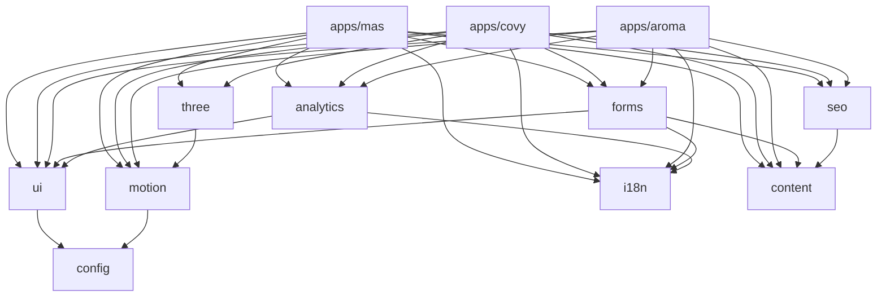
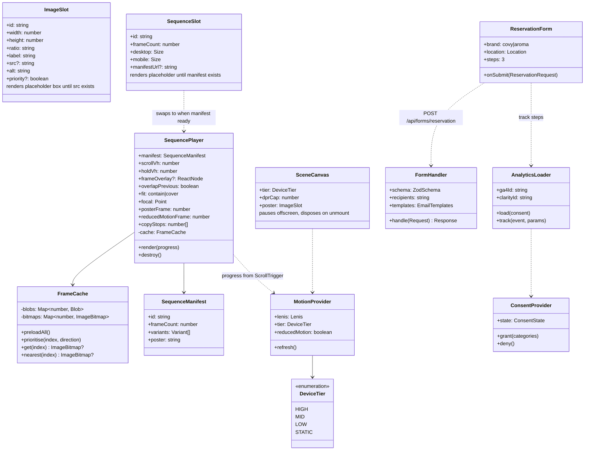
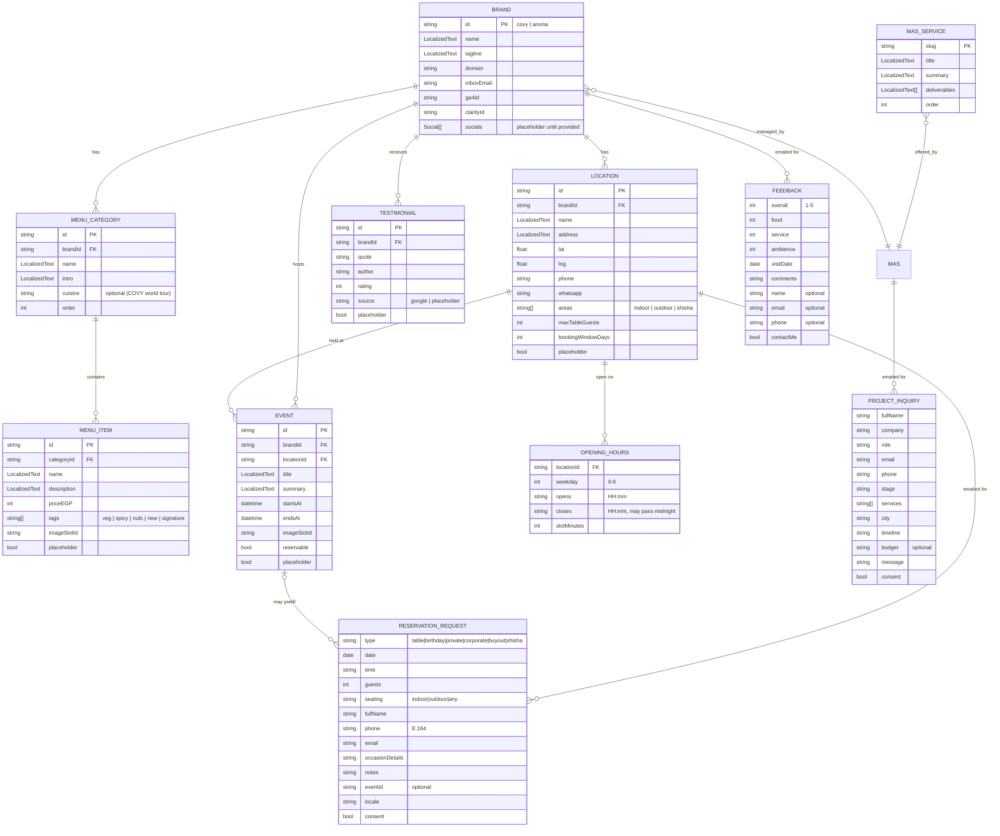
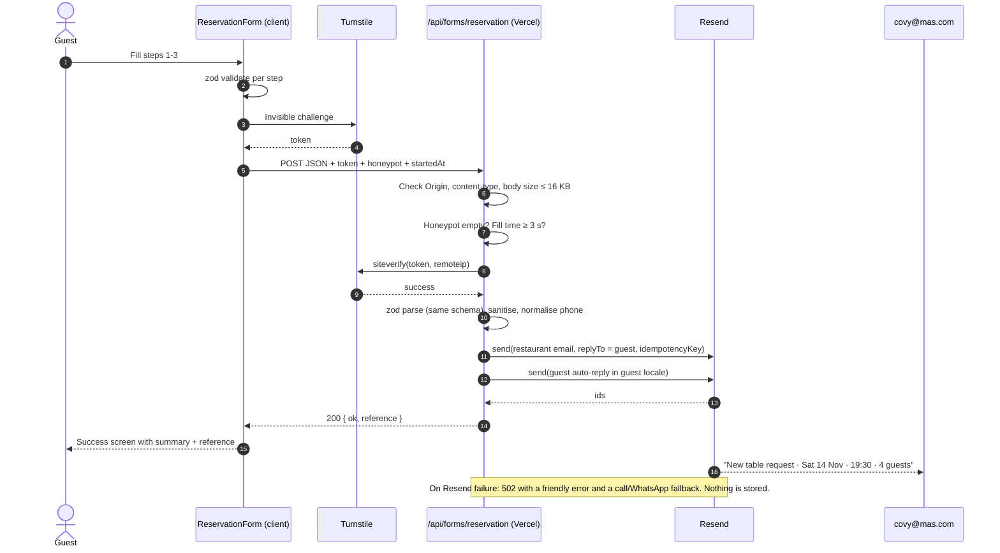
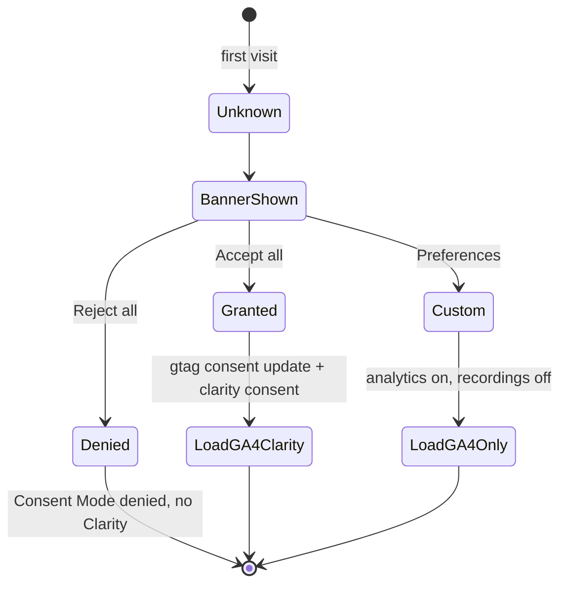

# Architecture & System Design

## 1. Overview

Three statically generated Next.js apps in one Turborepo, sharing packages for UI, motion, forms, analytics, i18n, SEO and content. The only server code is one form route per app that validates input and sends email through Resend. There is no database and no CMS.

```mermaid
flowchart LR
  subgraph Browser
    U[Visitor]
  end
  subgraph Vercel["Vercel (Hobby → client Pro)"]
    MAS[apps/mas<br/>mas.com]
    COVY[apps/covy<br/>covy.mas.com]
    AROMA[apps/aroma<br/>aroma.mas.com]
    FR["/api/forms/* route handlers<br/>(Node runtime)"]
  end
  subgraph Media["Media CDN (Cloudflare R2 · media.mas.com)"]
    SEQ[(Scroll-sequence frames<br/>AVIF / WebP)]
  end
  subgraph Third["Free third-party services"]
    TS[Cloudflare Turnstile]
    RS[Resend]
    GA[Google Analytics 4<br/>3 properties]
    CL[Microsoft Clarity<br/>3 projects]
  end
  INBOX[(mas@ / covy@ / aroma@<br/>inboxes)]
  GUEST[(Guest inbox)]

  U -->|HTML/CSS/JS| MAS & COVY & AROMA
  U -->|frames| SEQ
  U -->|token| TS
  U -->|POST form + token| FR
  FR -->|verify token| TS
  FR -->|send x2| RS
  RS --> INBOX & GUEST
  U -.->|after consent| GA & CL
```

## 2. Tech stack

Pin exact versions at project init after checking current releases. Versions below are the minimum we target.

| Concern | Choice | Why |
|---|---|---|
| Framework | Next.js (App Router), React, TypeScript strict | Owner's stack; SSG + one server route; first-class on Vercel |
| Monorepo | pnpm workspaces + Turborepo | Shared packages, cached builds, one Vercel project per app |
| Styling | Tailwind CSS (v4) with CSS-variable design tokens per brand | Same components, three themes; logical properties for RTL |
| Components | shadcn/ui (copied source) | Accessible primitives we fully own and restyle per brand |
| Motion | GSAP 3 (ScrollTrigger, SplitText, Flip) + Lenis | Industry standard; all plugins free for commercial use |
| 3D | three.js + React Three Fiber + drei, custom GLSL shaders | Real-time scenes where interactivity matters (MAS facets, COVY leaves) |
| i18n | next-intl | App Router support, typed messages, locale routing |
| Forms | react-hook-form + zod (schemas shared client/server) | One schema validates both sides |
| Email | Resend + React Email | Free tier fits; templates in React |
| Anti-spam | Cloudflare Turnstile (free) + honeypot + minimum fill time | No CAPTCHA puzzles for guests |
| Analytics | GA4 (Consent Mode v2) + Microsoft Clarity | Owner requirement; separate per site |
| Testing | Vitest, Testing Library, Playwright (+ axe), Lighthouse CI | Unit, component, e2e, a11y, perf budgets |
| Quality | ESLint, Prettier, TypeScript `--noEmit`, Knip (unused code) | CI gates |

## 3. Repository layout

```
mas/
├─ apps/
│  ├─ mas/                 # mas.com
│  │  └─ src/app/[locale]/(site)/{page,about,services/[slug],brands,events,insights/[slug],contact,privacy,terms}
│  ├─ covy/                # covy.mas.com  → src/app/[locale]/{page,privacy,terms}
│  └─ aroma/               # aroma.mas.com → src/app/[locale]/{page,privacy,terms}
│     (each app: src/app/api/forms/[form]/route.ts, src/theme.css, src/sections/*, messages/{en,ar}.json)
├─ packages/
│  ├─ ui/          # shadcn-based primitives, ImageSlot, SequenceSlot, LanguageSwitcher, Header/Footer shells
│  ├─ motion/      # LenisProvider, ScrollTrigger setup, SequencePlayer, SplitReveal, useReducedMotion, device tiering
│  ├─ three/       # R3F canvas shell, quality tiers, shared shaders (noise, facets, leaves), dispose helpers
│  ├─ forms/       # zod schemas, form components, server handler factory, React Email templates, Turnstile widget
│  ├─ analytics/   # ConsentProvider, CookieBanner, GA4 + Clarity loaders, typed event helpers
│  ├─ i18n/        # next-intl config, shared messages (forms, legal, consent), date/number formatting
│  ├─ seo/         # metadata builders, JSON-LD builders, sitemap/robots helpers
│  ├─ content/     # typed data: brands, locations, hours, menus, events, testimonials, services
│  └─ config/      # tsconfig, eslint, tailwind preset (tokens), prettier
├─ tools/
│  └─ sequences/   # ffmpeg/avif scripts: MAG video → frames → manifest
├─ docs/
└─ .claude/skills/
```

Dependency rule: `apps/*` → `packages/*`; packages never import apps. `content` and `config` depend on nothing internal.



## 4. Component model (class diagram)



## 5. Data model (ERD)

There is **no database**. The diagram below is the typed content model in `packages/content` plus the form payloads, which only travel in email and are never stored.



`LocalizedText = { en: string; ar: string }`. Each record carries `placeholder: true` until the client supplies real data; a CI check lists remaining placeholders before launch.

## 6. Form submission flow



The reference is a short random ID (e.g. `CV-7K3P`) shown to the guest and put in both email subjects, so staff and guest can match calls to requests.

## 7. Security plan

| Threat | Control |
|---|---|
| Spam / bots exhausting the 100 emails/day quota | Turnstile (server-verified), honeypot field, minimum fill time, body-size limit; plus a Vercel Firewall rate-limit rule if the plan allows it (to verify on Hobby; available on Pro) |
| Injection into emails (header/HTML) | zod schemas with length limits; React Email escapes content; no user input in `from`/headers except `replyTo` validated as email |
| XSS | No `dangerouslySetInnerHTML` with user data; JSON-LD serialised with `<` escaped; CSP with an allow-list of script hosts (GA4, Clarity, Turnstile) plus `object-src 'none'`, `base-uri 'self'`, `form-action 'self'`, `frame-ancestors 'none'`. Inline scripts stay allowed: per-request nonces would force every page to render dynamically and lose static generation (see `packages/config/next/security.js`) |
| CSRF / cross-site posting | `Origin` allow-list per app; JSON-only content-type; Turnstile token bound to site key |
| Secrets exposure | `RESEND_API_KEY`, `TURNSTILE_SECRET_KEY` server-only env vars; `server-only` import guard; separate keys per environment |
| Clickjacking & misc headers | `Content-Security-Policy`, `frame-ancestors 'none'`, `X-Content-Type-Options`, `Referrer-Policy: strict-origin-when-cross-origin`, `Permissions-Policy`, HSTS (on the custom domain) |
| Supply chain | Lockfile, `pnpm audit` in CI, Renovate/Dependabot, minimal dependencies, no runtime CDN scripts except GA/Clarity/Turnstile (CSP-allow-listed) |
| Privacy | Data minimisation; no storage; consent before analytics; Clarity masks form fields; privacy policy describes processors (Vercel, Resend, Cloudflare, Google, Microsoft) |
| Email spoofing / deliverability | Verify a sending subdomain (e.g. `send.mas.com`) in Resend with SPF + DKIM; DMARC on the root domain |

Reviewed with the `security-and-hardening` skill before Milestone A and again before launch.

## 8. Performance budget & 3D delivery

| Metric (mobile, Moto G Power / 4G profile) | Budget |
|---|---|
| LCP | ≤ 2.5 s (target 2.0 s). The LCP element is a poster image or headline, never the canvas |
| INP | ≤ 200 ms |
| CLS | ≤ 0.05; every slot reserves its aspect ratio |
| Initial JS per route (gzip) | ≤ 180 KB, excluding the lazily loaded 3D chunk and the motion library, which loads after first paint (D29) |
| 3D chunk (three + R3F + scene) | ≤ 250 KB gzip, loaded after first paint on HIGH/MID tiers only |
| Fonts | ≤ 2 preloaded files per locale, subset woff2 |
| Sequence poster | ≤ 120 KB AVIF |
| Sequence frames | Desktop 1920w AVIF ≈ 40–70 KB × ≤ 150 frames; mobile 1080×1350 portrait crop, every 2nd frame ≈ 25–35 KB; downloaded in full once the section is within about 1.5 viewports, frames near the scroll position first, never blocking first paint |

**Device tiers** (decided once on load in `MotionProvider`):

| Tier | Detection | Behaviour |
|---|---|---|
| HIGH | Desktop, good GPU, no Save-Data | Full sequences, WebGL at DPR ≤ 2, Lenis |
| MID | Mobile or `deviceMemory ≤ 4` | Mobile frame set, WebGL at DPR ≤ 1.5 with simplified shaders |
| LOW | `saveData`, 2G/3G effective type, or WebGL failure | Posters + light CSS/GSAP motion; no WebGL, no frames |
| STATIC | `prefers-reduced-motion: reduce` | Final states, no pinning/scrubbing, normal document flow |

**Where the frames live (D25):** each sequence is ~5–8 MB per full desktop view, so frames don't go through Vercel. Vercel Hobby includes about 100 GB/month of fast data transfer, roughly 12–20k full sequence views. Frames live in a Cloudflare R2 public bucket behind `media.mas.com` (free: 10 GB storage, no egress fees; all five sequences ≈ 150 MB). A Cloudflare cache rule serves repeat requests from the edge, so they don't count against R2's free monthly operations. It's static file hosting, not a backend. Activating R2 requires a card or PayPal for verification; there is no charge inside the free tier.

## 9. Internationalisation

- next-intl with `[locale]` segment; `localePrefix: 'as-needed'` → English at `/`, Arabic at `/ar` (D27).
- `<html lang dir>` set per locale; Tailwind logical utilities (`ms-*`, `pe-*`, `start-*`) only; horizontal scroll sections and directional motion read `dir` and mirror.
- Fonts per brand and locale (see `03-experience-design.md` §2).
- Numbers/dates via `Intl` with Western digits (0-9) in both languages (D26), e.g. `ar-EG-u-nu-latn`; prices `EGP`/`ج.م`.
- All content records use `LocalizedText`; CI fails if a key is missing in either language.

## 10. Analytics & consent



Consent stored in a first-party cookie for 6 months, editable from the footer link "Cookie settings". **Key events:** `reservation_start`, `reservation_step` (1–3), `reservation_submit_success|error`, `feedback_submit`, `inquiry_submit`, `menu_category_view`, `menu_search`, `sequence_complete` (per sequence id), `cta_click`, `brand_portal_click`, `language_switch`, `phone_click`, `whatsapp_click`, `map_click`.

## 11. Environments & deployment

| Env | Where | Domains | Email |
|---|---|---|---|
| Local | `pnpm dev` | localhost:3000/3001/3002 | Resend test mode → developer inbox |
| Preview | Vercel Hobby, one project per app (root dir `apps/<name>`) | `*.vercel.app` per branch | Test inboxes |
| Production | Client's Vercel Pro team | `mas.com`, `www.mas.com`, `covy.mas.com`, `aroma.mas.com` | Real inboxes |

Env vars per app: `RESEND_API_KEY`, `MAIL_FROM`, `MAIL_TO`, `TURNSTILE_SECRET_KEY`, `NEXT_PUBLIC_TURNSTILE_SITE_KEY`, `NEXT_PUBLIC_GA4_ID`, `NEXT_PUBLIC_CLARITY_ID`, `NEXT_PUBLIC_SITE_URL`, `NEXT_PUBLIC_MEDIA_URL`, `SITE_INDEXABLE` (set to `true` on production only at launch; until then every page is `noindex` and robots.txt disallows crawling, so placeholder data never gets indexed).

**DNS at launch (owner):** CNAMEs for `covy` and `aroma` (and `www`) to Vercel, apex A/ALIAS for `mas.com`, Resend SPF/DKIM records for the sending subdomain, DMARC TXT, `media` custom domain for the R2 bucket.

**CI (GitHub Actions):** install → lint → typecheck → unit tests → build all apps (Turbo cache) → Playwright e2e + axe on preview → Lighthouse CI budgets → placeholder report.

## 12. Testing strategy

| Layer | What |
|---|---|
| Unit (Vitest) | zod schemas, time-slot generation (incl. after-midnight hours), phone normalisation, locale formatting, frame-window selection |
| Component | Forms (steps, errors, RTL), ImageSlot/SequenceSlot rendering, consent banner |
| E2E (Playwright) | Reservation happy path + validation, language switch, reduced-motion mode, no-WebGL mode, keyboard-only booking |
| Visual | Screenshots at 390/768/1024/1440 in EN and AR |
| Performance | Lighthouse CI budgets; manual check on a mid-range Android device |
| Accessibility | axe in e2e; manual screen-reader pass (VoiceOver, TalkBack) on forms and menu |
