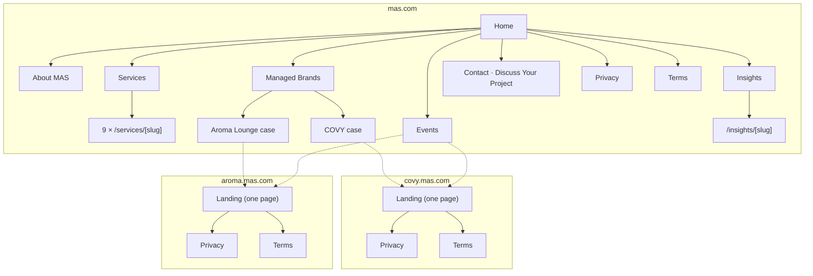

# Experience Design — Brands, Sitemaps, 3D Storyboards, Forms

## 1. How the "3D scrolling experience" is built

The reference video (laptop showing an iced crème-brûlée latte being built as you scroll) is **not real-time 3D**. It is a pre-rendered photoreal clip cut into ~100–200 frames. A `<canvas>` draws the frame that matches the scroll position, and copy, hotspot labels and the CTA are HTML layered on top. That is why it looks like film and still runs smoothly.

We use three layers, and each scene picks the right one:

| Layer | Use it for | Tech | Asset source |
|---|---|---|---|
| **A. Cinematic sequence** | Photoreal "wow" moments: pours, fly-throughs, transformations | `SequencePlayer` (canvas image sequence, GSAP ScrollTrigger scrub, pinned stage) | Generated with MAG video models (Seedance 2.5 / Kling 2.5 using start/end frames) → ffmpeg → AVIF/WebP frames |
| **B. Real-time 3D** | Things that react to cursor/scroll and need no photo realism: geometry, particles, shaders | React Three Fiber + custom GLSL | Procedural geometry; GLB from MAG `models3d_generate` or CC0 models (Poly Haven) when needed |
| **C. Motion design** | Typography, reveals, menu transitions, line drawings, UI | GSAP (SplitText, Flip), Lenis, SVG stroke drawing, CSS | Code + designer stills |

Rules (from the installed `scroll-scrubbed-visual-sequence` and `build-awwwards-quality-sites` skills): scroll position is the only source of truth, reversible in both directions; no text or logos baked into frames; poster first; semantic HTML for all copy; complete static fallback for reduced motion, slow networks and no-WebGL; one smooth-scroll engine (Lenis).

Each brand has its own motion personality:

| Brand | Motion personality | Easing / pace |
|---|---|---|
| MAS | Precise, architectural, confident; hard cuts of crimson light | `power3.out`, short durations, tight staggers |
| COVY | Dreamy, surreal, floating; things drift and sparkle (the ✦ star in the logo) | `sine.inOut`, slow drifts, long scroll distances |
| Aroma Lounge | Warm, relaxed, generous; steam, golden light, hand-drawn lines | `power2.inOut`, medium pace, drawn strokes |

## 2. Brand systems (design tokens)

### MAS — Proposal A

| Token | Value |
|---|---|
| `--bg` Obsidian Black | `#0B0B0C` |
| `--accent` Deep Crimson | `#C21F30` |
| `--fg` Warm Ivory | `#F3EFE7` |
| `--surface` Graphite | `#28282A` |
| Display | **Bebas Neue** (condensed caps, echoes the MAS wordmark) |
| Text (Latin) | **Inter** (used in the strategy deck) |
| Arabic | **IBM Plex Sans Arabic** (text) · **Cairo** Bold (display) |
| Motifs | Faceted obsidian polygons, thin crimson rules under section labels, numbered services |

### COVY

Hex values sampled from the brand guide (no codes are printed in it); confirm with the brand designer.

| Token | Value |
|---|---|
| `--navy` | `#262D3F` |
| `--slate-blue` | `#7E98AE` |
| `--cocoa` | `#765F4D` |
| `--sand` | `#DCD4CF` |
| `--bronze` (interior accent) | `#B08D57` (approx., from laser-cut screens) |
| Display (PassionSans substitute) | **Tenor Sans** for all-caps titles; **Marcellus** for large editorial headings |
| Text | **Outfit** (light/regular) |
| Arabic | **El Messiri** (display) · **Readex Pro** (text) |
| Motifs | Caladium leaf veins (two-tone blue/cocoa duotone), the ✦ four-point star, arches, the blue tree, terrazzo specks, bronze leaf lattice |

### Aroma Lounge

| Token | Value (from guide) |
|---|---|
| `--charcoal` | `#202722` |
| `--green` | `#8EB57A` |
| `--beige` | `#E6E3D8` |
| `--grey` | `#ABA6A6` |
| Supporting | Copper `#A5673F`, Rust `#5C2E1F`, Forest `#355E3B`, Butter `#F5E6B8` |
| Display / text (Telegraf substitute) | **Hanken Grotesk** (closest free grotesk; weights 300–800) |
| Arabic | **Alexandria** (wide geometric, pairs with Telegraf's proportions) |
| Logo | Client's script wordmark + petal icon as SVG (never re-typeset) |
| Motifs | Black-and-white botanical line drawings, petal icon, double rules with section labels (from the guide), dark wood and golden accents |

## 3. Sitemaps



All routes exist in `/` (en) and `/ar`.

## 4. Storyboards

Scene IDs match the asset manifest. "Seq" = Layer A, "RT3D" = Layer B, "Motion" = Layer C. Scroll length is in viewport heights (vh).

### 4.1 MAS — Home: "From idea to operations"

| # | Scene | Layer | What happens on scroll | Scroll |
|---|---|---|---|---|
| M1 | **Obsidian field** (hero) | RT3D | A dark faceted surface (the deck's polygon background) catches a crimson light sweep. MAS wordmark and the line "Supporting business owners to achieve their goals." resolve word by word. The cursor tilts the facets slightly. Scrolling pushes the camera *into* the facets | 150vh |
| M2 | Vision | Motion | Large statement typesetting; "Supporting" in crimson; supporting paragraph fades in by line | 100vh |
| M3 | **Nine facets** (services) | RT3D + Motion | A pinned obsidian polyhedron rotates one face per service. The active face lights up crimson while the service title, number (01–09) and two-line summary swap beside it. Keyboard/list fallback shows all nine as a list | 400vh |
| M4 | Scope of support | Motion | A crimson line draws through Strategy → Marketing → Recruitment → Training → Guest Experience; each node reveals a short sentence | 120vh |
| M5 | **Two doors** (managed brands) | Seq `mas.portal` | The camera moves down a dark stone corridor that splits into two arches: blue jungle light (COVY) left, warm golden lounge light (Aroma Lounge) right. Brand cards with logos are HTML on top and link to the subdomains | 250vh |
| M6 | Events teaser | Motion | Next 3 events from both brands, horizontally scrubbed cards | 100vh |
| M7 | CTA | Motion | "Discuss your project" with the crimson button; footer | — |

### 4.2 COVY — Landing: "The Blue Jungle"

| # | Scene | Layer | What happens on scroll | Scroll |
|---|---|---|---|---|
| C1 | **Through the arches** (hero) | Seq `covy.hero` | Starts on the arched concrete facade covered in blue flowers under a soft sky. The camera pushes through the glass doors, past terrazzo and the bronze leaf screens, and stops facing the iconic blue tree as the ✦ star glints. COVY logo (SVG) settles in. Start/end frames come from the client's interior renders | 300vh |
| C2 | **To the bar** (our story) | Seq `covy.connector` | Picks up on the hero's last frame. Following the real floor plan, the camera turns left along the mural, crosses the terrazzo to the barista bar and pushes in on a glass of ice on the pastry case, landing on the first frame of C3 (D38). The brand belief ("food is the most delicious way to connect cultures") rides over the turn on a soft navy pool | 400vh |
| C3 | **The signature cup** | Seq `covy.signature` | The signature iced latte builds in the glass on the pastry case, the real bar softly blurred behind (D38): milk, double espresso, cold foam, cocoa. Hotspot labels (HTML) appear at their stops; the COVY wordmark is printed on the glass (HTML, D35/D38) | 280vh |
| C6 | **The rooms behind the arches** (spaces) | Motion | Indoor · Terrace · The bar · Photo corner, three photos each (D39). A sticky index on the left numbers the spaces and lights the one in view (a row of tabs on phones); each space is a large photo in the facade's arch shape, opening from a slit on scroll, with two smaller photos drifting at a second depth. Any photo opens a full-screen viewer for all 12 (arrows, swipe, Esc) | flow |
| C5 | **Menu** | Motion (+RT3D leaves on HIGH tier) | See §5 | flow |
| C7 | Events at COVY | Motion | From shared events data | — |
| C8 | Testimonials | Motion | Placeholder quotes marked "Sample" until Google Reviews arrive | — |
| C9 | Reserve / Feedback | UI | Tabs: "Book a table or event" / "Share your feedback" | — |
| C10 | Find us | UI | Address, hours, phone, WhatsApp, map link (placeholders); footer with socials. The arch photo is our terrace view of the glass doors (D42) | — |

Page order: C1, C2, C3, C6, C5, C7–C10. **C4 The Taste of Everywhere** (the 3D leaf ring through five kitchens) is off the COVY page since D42; its code stays in the repo (`taste.tsx`, `cuisines.tsx`, `@mas/three` leaf ring) to rework for Aroma Lounge in Aroma's identity.

### 4.3 Aroma Lounge — Landing: "Good food, good hearts"

| # | Scene | Layer | What happens on scroll | Scroll |
|---|---|---|---|---|
| A1 | **Aroma rising** (hero) | Seq `aroma.hero` + Motion | Dark wood table at golden hour; steam rises from a just-served paella pan and curls upward. As it rises, the script "Aroma Lounge" wordmark draws itself stroke by stroke (SVG overlay, not in the frames) | 250vh |
| A2 | Motto | Motion | "Good food comes from good hearts, we aspire for both." — Mahmoud Younes, Founder | 100vh |
| A3 | Since 2006 | Motion | Timeline: City Stars opening (1,200 m², 900 m² terrace) → two major upgrades → today; numbers count up | 150vh |
| A4 | Passion · Diversity · Creativity | Motion | Three pinned panels; botanical line drawings (guide's pattern) draw in with each value | 200vh |
| A5 | **Terrace, dusk to night** | Seq `aroma.terrace` | Wide terrace shot: daylight → golden hour → evening, warm lights switch on, plants sway. Copy: the chill-out experience | 250vh |
| A6 | **Menu** | Motion | See §5 (line-drawing category art) | flow |
| A7 | Events, Testimonials, Reserve/Feedback, Find us | UI | Same structure as COVY, Aroma styling | — |

## 5. Menu experience (COVY & Aroma)

The menu is long content, so it must stay fast and scannable. The "wow" sits in transitions, not in fighting the user.

- **Category chapter openers:** each category starts with a short pinned moment (≤ 80vh): a large category title split by letters, a hero dish ImageSlot that scales from a card to full-bleed, and on COVY a caladium leaf that turns and settles (RT3D on HIGH tier, CSS on others). On Aroma a botanical line drawing draws itself.
- **Item list:** two-column on desktop, one on mobile; name, short description, price, dietary tags, ImageSlot thumbnail. Items reveal with a restrained stagger and are never hidden behind animation.
- **Sticky category bar** with scroll-spy (Flip-animated indicator), RTL mirrored; on mobile a bottom sheet "Jump to category".
- **Search & filter** (client-side, instant): text search, tags (veg, spicy, signature, new).
- **Reserve from the menu:** a floating "Book a table" button that opens the reservation sheet.
- Content is real HTML for SEO, with `Menu`/`MenuSection`/`MenuItem` JSON-LD.

## 6. Forms UX

Shared visual language: big tappable fields, labels always visible, inline validation on blur, errors in plain language in both languages, everything reachable by keyboard, `autocomplete` attributes, `inputmode` for phone and numbers, no CAPTCHA puzzles (Turnstile is invisible).

### 6.1 Reservation (COVY, Aroma) — 3 steps in a sheet/section

| Step | Fields | Notes |
|---|---|---|
| 1 · What & when | **Type** (cards with icons: Table · Birthday · Private celebration · Corporate · Full-venue buyout · Shisha area) · **Date** (calendar, past disabled, window 60 days) · **Time** (chips from opening hours, 30-min slots) · **Guests** (stepper; table 1–20, events 10–300 ranges) · **Seating** (Indoor / Outdoor / No preference) | Selecting an event type reveals "Tell us about the occasion" in step 2. Guests above the table limit suggest switching to an event type |
| 2 · Your details | **Full name** · **Mobile** (default +20, validated, normalised to E.164) · **Email** (for the confirmation) · **Occasion details** (event types) · **Special requests** (allergies, high chair, accessibility, decoration) | Privacy consent checkbox with link to policy |
| 3 · Review & send | Summary card, edit links per step | On success: reference number, "Your request isn't confirmed yet — the team will call you shortly to confirm," plus call and WhatsApp buttons |

The **restaurant email** subject is `[COVY] Birthday · Sat 14 Nov 2026 · 19:30 · 8 guests · CV-7K3P`. The body is a table with every field and one-tap `tel:`/`wa.me`/`mailto:` links. Reply-To is the guest's email. The **guest auto-reply** uses the guest's language, brand styling, the request summary and contact links.

### 6.2 Feedback (COVY, Aroma)

Star ratings (overall required; food/service/ambience optional) · visit date · comments (required, 10–2,000 chars) · "Contact me about this feedback" toggle → name, email/phone. Low overall scores (≤ 2) are flagged `[Needs follow-up]` in the email subject.

### 6.3 "Discuss Your Project" (MAS)

| Field | Type | Required |
|---|---|---|
| Full name | text | ✓ |
| Company / brand name | text | — |
| Your role | select: Owner · Investor · Manager · Other | ✓ |
| Email | email | ✓ |
| Mobile | tel (+20 default) | ✓ |
| Business stage | cards: Idea · Opening soon · Operating (1 branch) · Multi-branch / franchise | ✓ |
| Services of interest | multi-select chips (the 9 services) | ✓ (≥ 1) |
| City | text with suggestions (Cairo, Giza, Alexandria, North Coast, Other) | — |
| Timeline | select: ASAP · 1–3 months · 3–6 months · 6+ months | — |
| Budget range | select incl. "Prefer not to say" | — |
| Project details | textarea 20–3,000 chars | ✓ |
| Consent | checkbox | ✓ |

The email goes to `mas@mas.com`; the auto-reply says the team will respond within one business day.

## 7. Placeholder system (owner rule)

```tsx
<ImageSlot id="covy.menu.mezze.hero" width={1600} height={1000} alt="Mezze platter" />
```

Renders, until `src` is provided:

```
┌──────────────────────────────────────────┐
│                                          │
│        1600 × 1000 px · 16:10            │
│        covy.menu.mezze.hero              │
│        Mezze platter                     │
│                                          │
└──────────────────────────────────────────┘
```

- The box uses the brand's surface colour, a 1 px dashed border and a subtle diagonal hatch, so it can never be mistaken for a final image.
- It reserves the exact aspect ratio responsively (CLS 0). It shows the *delivery* size (2× the largest rendered size), not the CSS size.
- `SequenceSlot` shows `Sequence · 150 frames · 1920×1080 (desktop) / 1080×1350 (mobile) · covy.hero`.
- `pnpm assets:manifest` generates `docs/assets/asset-manifest.md` from the code: slot ID, page, section, delivery size, ratio, format (AVIF/WebP master as PNG/TIFF), alt text EN/AR, status. This is the designer's checklist.

## 8. Writing & content

- Copy is written by us with the `copywriting` skill, then edited with `humanizer` and `no-ai-slop`. Arabic is written natively (not machine-translated) and reviewed by the client.
- Voice: **MAS** confident and practical; **COVY** poetic and well-travelled; **Aroma Lounge** warm, generous, welcoming.
- No superlatives we can't support, no invented numbers, no fake reviews (from the copywriting skill's rules and D7).
