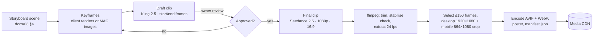

# Asset Pipeline — MAG Sequences, 3D Models, Designer Images

## 1. Who makes what

| Asset | Made by | Delivered as |
|---|---|---|
| Still images (heroes, dishes, spaces, events, OG images) | **Graphic designer** | Master PNG/TIFF at the slot's delivery size → we encode AVIF/WebP |
| Scroll sequences (Layer A) | **Us, with MAG** | Video → frames via `tools/sequences` |
| Real-time 3D (Layer B) | **Us** | Procedural geometry/shaders; GLB from MAG `models3d_generate` or CC0 sources only when needed |
| Logos | **Client / brand designers** | SVG (all variants: full, icon, mono light/dark) |

Until a designer image exists, its `ImageSlot` placeholder is shown (owner rule, `CLAUDE.md` §3).

## 2. Sequence production steps

1. **Keyframes:** start and end frames define each shot. For COVY we use the client's interior renders (facade, blue tree, bar, terrazzo) as references or start frames, so the generated space matches the real restaurant. For MAS and Aroma we generate keyframes in brand colours with MAG image models.
2. **Drafts:** Kling 2.5 at 1080p, 10 s, start + end frame (650 credits each). We iterate on motion and camera path cheaply here.
3. **Final:** Seedance 2.5 at 1080p, 16:9, 10 s, with the approved keyframes as references (7,900 credits each).
4. **Mobile:** cropped from the 16:9 master to 4:5 (864×1080) around a per-scene focal point, so no second generation is needed.
5. **Rules for prompts:** no text, logos, people's faces in close-up, or brand marks inside frames; slow, steady camera moves (they scrub better); constant lighting direction; neutral areas reserved where HTML copy will sit.
6. **Processing (`tools/sequences`):** `ffmpeg` extracts frames at 24 fps → we pick up to 150 frames evenly in time (scrub smoothness vs weight), or, with `--motion-step`, by how much the image changes, so fast camera moves keep every frame and the manifest carries a `timing` curve the player scrubs along at an even camera speed (D41) → `avifenc`/ffmpeg AV1 encode at quality tuned per scene → WebP fallback → poster frame → `manifest.json` (`id`, `frameCount`, variants, sizes, poster, focal point, `copyStops`).

## 3. Credit budget (MAG, already-paid plan)

Balance on 2026-10-29: **365,361 credits** (Premium+; unlimited mode not active here, so generations consume credits). Prices below are exact quotes from MAG's cost simulator.

| Item | Unit cost | Per sequence | × 5 sequences |
|---|---|---|---|
| Keyframe images (~4) | ~100 | 400 | 2,000 |
| Kling 2.5 drafts 1080p 10 s (~4) | 650 | 2,600 | 13,000 |
| Seedance 2.5 finals 1080p 10 s (up to 2) | 7,900 | 15,800 | 79,000 |
| **Subtotal** | | **18,800** | **94,000** |
| 3D models (Tripo 3.1, if needed, ~2) | 580 | — | 1,160 |
| Contingency (re-shoots, upscales) | | | 15,000 |
| **Project cap** | | | **≈ 110,000 credits (~30% of balance)** |

Sequences: `mas.portal`, `covy.hero`, `covy.signature`, `aroma.hero`, `aroma.terrace`. Before every generation batch we post the exact quote and wait for approval.

## 4. 3D models (only if a scene needs a mesh)

Candidates: COVY blue tree (if we move it into real-time for the menu openers), COVY cup. Pipeline: MAG `models3d_generate` (Tripo 3.1 from client renders) → `models3d_remesh` if needed → glTF-Transform (Meshopt + KTX2 textures) → ≤ 1.5 MB GLB, lazy loaded. CC0 alternatives from Poly Haven are checked first for generic props.

## 5. Designer handoff

- `docs/assets/asset-manifest.md` (generated from code) lists every slot: ID, page/section, delivery size, ratio, alt text EN/AR, status.
- Masters are delivered at 2× the largest rendered size; we handle compression and responsive variants.
- Food photography direction per brand: COVY in cool blue/cocoa light with terrazzo and bronze; Aroma Lounge in warm wood, golden light and green accents; MAS in dark, high-contrast, crimson-accented.
