# Master Plan

Work moves through gated phases. A phase starts only after the owner approves the previous one. Milestone A, the client demo of the three home/landing pages, is the first external gate.

```mermaid
flowchart LR
  P0[P0 · Planning] --> P1[P1 · Foundations]
  P1 --> P2[P2 · Art direction &<br/>motion prototypes]
  P2 --> P3[P3 · COVY landing]
  P3 --> P4[P4 · Aroma landing]
  P4 --> P5[P5 · MAS home]
  P5 --> MA{{Milestone A<br/>client demo}}
  MA --> P6[P6 · MAS full site]
  P6 --> P7[P7 · Real content swap]
  P7 --> P8[P8 · Pre-launch hardening]
  P8 --> MB{{Milestone B<br/>client sign-off}}
  MB --> P9[P9 · Launch & handover]
```

## P0 — Discovery & planning ✅ (awaiting approval)

Deliverables: decision log, PRD, architecture & system design (diagrams), experience design & storyboards, asset pipeline & credit budget, this plan, `CLAUDE.md`, 28 vetted skills.
**Gate:** owner approves the docs and answers open items O1–O3.

## P1 — Foundations

- Turborepo + pnpm, three Next.js apps, shared packages skeletons, strict TS, lint/format, CI pipeline.
- Design tokens + Tailwind presets for MAS / COVY / Aroma; free fonts with Arabic pairs; RTL utilities.
- next-intl routing (`/`, `/ar`), language switcher, shared messages.
- `ImageSlot`, `SequenceSlot`, asset-manifest generator.
- `MotionProvider` (Lenis + ScrollTrigger + device tiers + reduced motion), `SequencePlayer` working with a test sequence.
- Consent banner + GA4/Clarity loaders (test IDs), legal page templates.
- Forms package: schemas, reservation/feedback/inquiry components, route handler, React Email templates, Turnstile; Resend in test mode.
- Three Vercel Hobby projects with preview deployments.
**Gate:** owner reviews a "kitchen sink" preview page per brand (tokens, type, slots, forms, a scrubbed test sequence, consent).

## P2 — Art direction & motion prototypes

- One art-direction board per brand built in the browser (type, colour, texture, motion samples).
- MAG keyframes + Kling drafts for all five sequences (≈ 15k credits, quoted first).
- Real-time prototypes: MAS obsidian field + nine-facet polyhedron; COVY leaf ring.
- Performance check of prototypes on a mid-range Android phone.
**Gate:** owner approves the look and motion of each scene before finals are generated.

## P3 — COVY landing (EN + AR)

Final `covy.hero` and `covy.signature` sequences; all sections C1–C10; placeholder menu (all categories); reservation + feedback live to test inbox; JSON-LD (Restaurant, Menu); privacy/terms. Reviews: `audit-ai-design-slop`, `review-animations`, `accessibility`, `core-web-vitals`.

## P4 — Aroma Lounge landing (EN + AR)

Same as P3 with sections A1–A7 and sequences `aroma.hero`, `aroma.terrace`.

## P5 — MAS home (EN + AR)

Sections M1–M7, `mas.portal` sequence, real-time scenes, links to brand subdomains (preview URLs).

## Milestone A — Client demo

Run the acceptance criteria in `01-prd.md` §8, give the owner a demo script with preview links, and collect feedback.
**Gate:** client approval → P6.

## P6 — MAS full site

About, Services index + 9 service pages, Managed Brands (2 case pages), Events (filters, upcoming/past), Insights (MDX list + article template + 2 starter articles), Contact with inquiry form, privacy/terms. Same review skills as above.

## P7 — Real content swap

Client delivers the real menu and prices, locations, hours, phones/WhatsApp, social links, logo SVGs, events and Google Reviews testimonials. The designer delivers images for all slots. Placeholder report reaches zero. Client reviews the Arabic copy.

## P8 — Pre-launch hardening

SEO (`seo-audit`, `ai-seo`, `schema`): metadata, OG images, sitemaps, robots, hreflang, `llms.txt`. Security review (`security-and-hardening`), CSP finalised, headers verified. Full a11y and performance audits, cross-browser/device QA, email deliverability test (SPF/DKIM/DMARC), consent and analytics verification on the client's GA4/Clarity.
**Gate:** Milestone B, client sign-off.

## P9 — Launch & handover

Client creates or upgrades to Vercel Pro and we transfer the projects. DNS cutover (apex, `www`, `covy`, `aroma`, Resend records, optional `media`). Production env vars, Search Console verification, smoke tests, 48-hour monitoring. Handover pack: runbook (how to edit menu/events data, add an article, rotate keys), credentials checklist, asset sources.

## Inputs needed from the client (collected in P7, not blocking earlier phases)

Real menus + prices · opening hours per location · addresses + map pins · phone/WhatsApp · social links · logo SVG files (MAS, COVY, Aroma Lounge) · events list · Google Reviews permission · legal entity name/address for privacy policy · reservation policies (max party size, lead time, shisha minimum charge, cancellation) · Google & Microsoft accounts for GA4/Clarity · Vercel Pro account at handover.

## Risks

| Risk | Impact | Mitigation |
|---|---|---|
| Resend free cap: 100 emails/day (≈ 50 reservations/day with auto-replies) | Lost emails on busy days | Turnstile + honeypot; monitor usage; client can upgrade Resend at handover if volume needs it |
| Vercel Hobby is non-commercial and has bandwidth limits | Can't launch publicly on Hobby | Previews only on Hobby; production on the client's Pro; sequence frames on R2 (O1) |
| AI video artifacts or off-brand details | Weak "wow", looks AI | Client renders as start frames, short controlled shots, no text in frames, owner review at drafts, `audit-ai-design-slop` |
| Mobile performance with sequences + WebGL | Poor CWV, battery drain | Device tiers, mobile crops at half frame rate, lazy 3D chunk, posters for LCP |
| Font substitutes drift from brand | Brand mismatch | Visual comparison in P2; owner approval |
| Arabic copy quality | Credibility | Native writing + client review in P7 |
| Placeholder content left at launch | Misleading info | `placeholder: true` flags + CI report must be zero before Milestone B |
