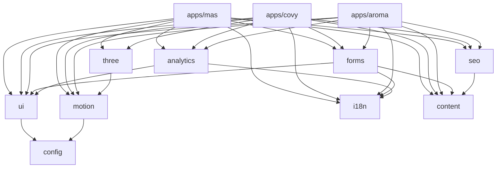
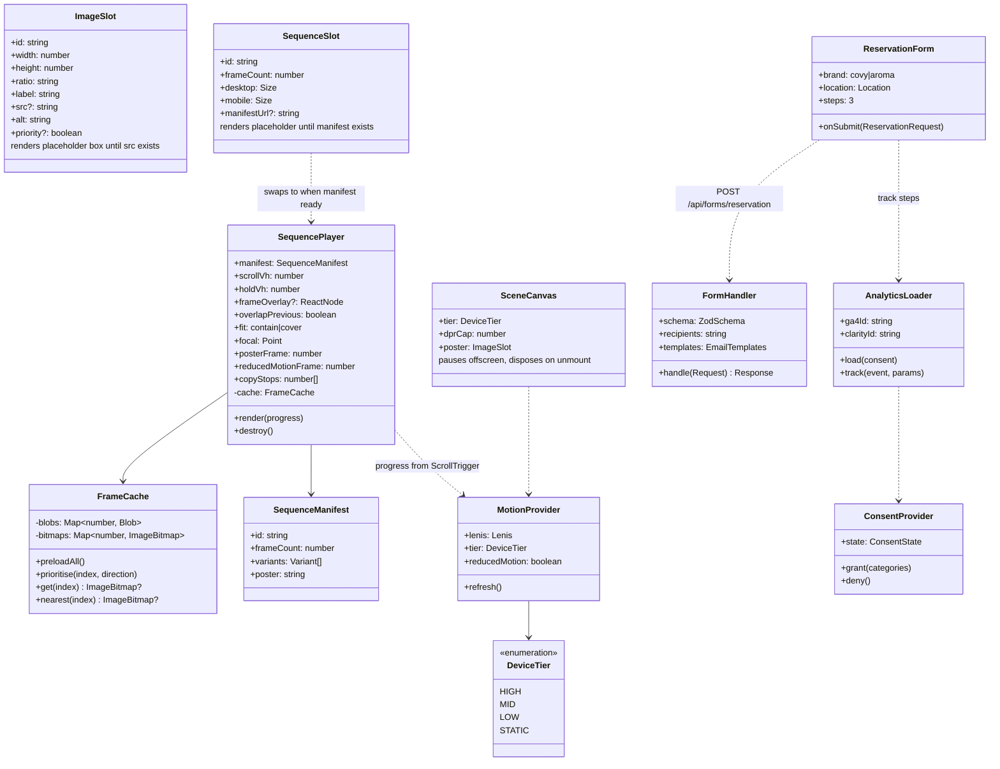
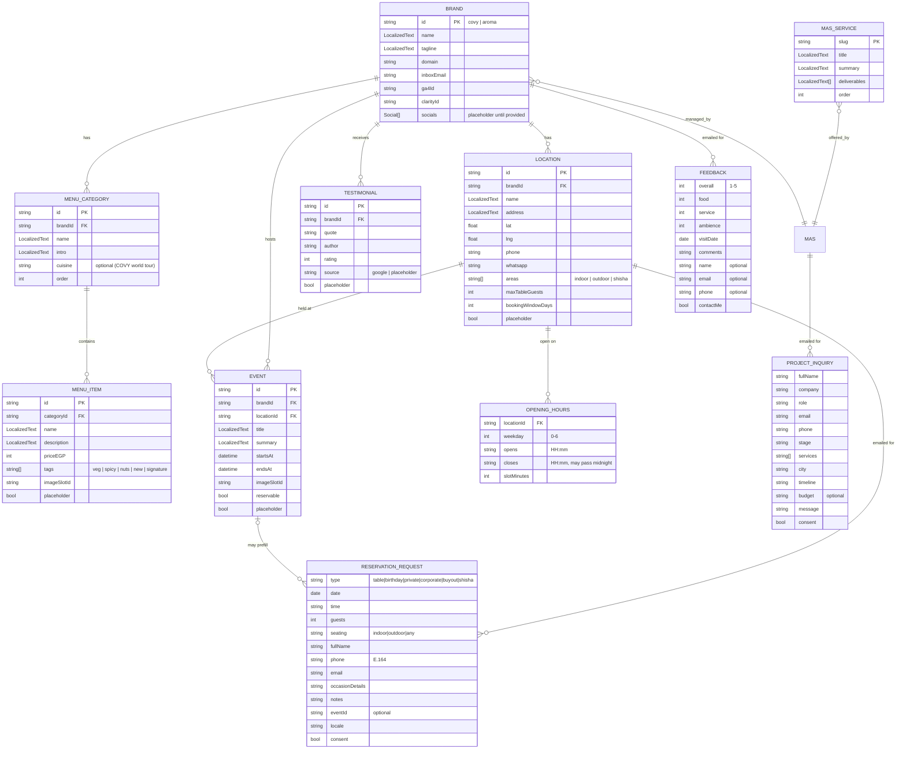
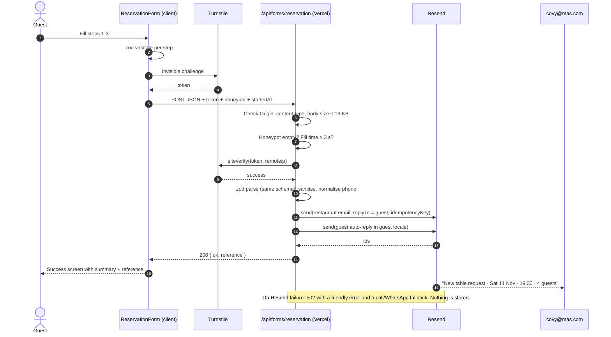
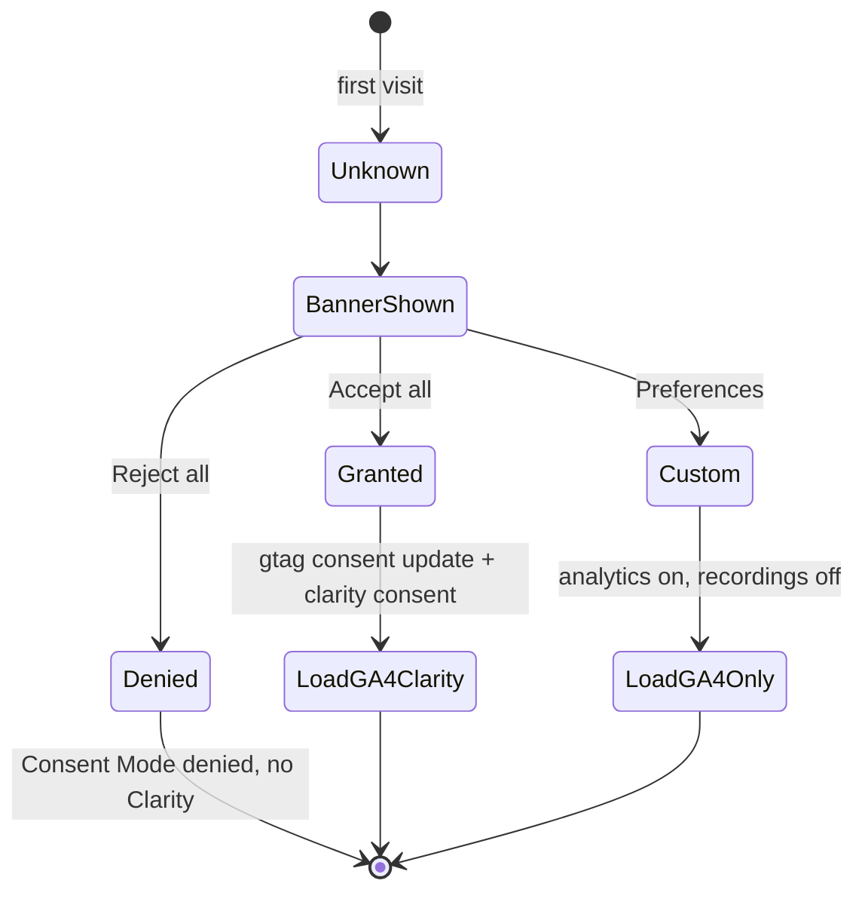

# المعمارية وتصميم النظام

## 1. نظرة عامة

تلات تطبيقات Next.js بتتولد صفحاتها static، جوه Turborepo واحد، وبيشتركوا في packages للـ UI والحركة والفورمز والأناليتكس واللغات والـ SEO والمحتوى. كود السيرفر الوحيد هو route لكل تطبيق بيتحقق من بيانات الفورم ويبعت إيميل عن طريق Resend. مفيش داتابيز ومفيش CMS.

> الرسومات التوضيحية بالإنجليزي عشان أسامي العناصر فيها هي نفس الأسامي اللي في الكود.

```mermaid
flowchart LR
  subgraph Browser
    U[Visitor]
  end
  subgraph Vercel["Vercel (Hobby → client Pro)"]
    MAS[apps/mas<br/>mas.com]
    COVY[apps/covy<br/>covy.mas.com]
    AROMA[apps/aroma<br/>aroma.mas.com]
    FR["/api/forms/* route handlers<br/>(Node runtime)"]
  end
  subgraph Media["Media CDN (Cloudflare R2 · media.mas.com)"]
    SEQ[(Scroll-sequence frames<br/>AVIF / WebP)]
  end
  subgraph Third["Free third-party services"]
    TS[Cloudflare Turnstile]
    RS[Resend]
    GA[Google Analytics 4<br/>3 properties]
    CL[Microsoft Clarity<br/>3 projects]
  end
  INBOX[(mas@ / covy@ / aroma@<br/>inboxes)]
  GUEST[(Guest inbox)]

  U -->|HTML/CSS/JS| MAS & COVY & AROMA
  U -->|frames| SEQ
  U -->|token| TS
  U -->|POST form + token| FR
  FR -->|verify token| TS
  FR -->|send x2| RS
  RS --> INBOX & GUEST
  U -.->|after consent| GA & CL
```

## 2. التقنيات

بنثبّت أرقام النسخ بالظبط وقت إنشاء المشروع بعد ما نشوف آخر الإصدارات.

| الجزء | الاختيار | ليه |
|---|---|---|
| الفريمورك | Next.js (App Router)، React، TypeScript strict | ده الستاك بتاعك، وبيدعم SSG + server route واحد، وشغال أحسن حاجة على Vercel |
| المونوريبو | pnpm workspaces + Turborepo | packages مشتركة، وبيلد متخزن في كاش، ومشروع Vercel لكل تطبيق |
| الستايل | Tailwind CSS (v4) مع design tokens كـ CSS variables لكل براند | نفس الكومبوننتس بتلات ثيمات، وlogical properties عشان RTL |
| الكومبوننتس | shadcn/ui (السورس عندنا) | عناصر accessible نملكها بالكامل ونعيد تصميمها لكل براند |
| الحركة | GSAP 3 (ScrollTrigger وSplitText وFlip) + Lenis | المعيار في المجال، وكل الـ plugins مجانية حتى للاستخدام التجاري |
| الـ 3D | three.js + React Three Fiber + drei، وshaders بـ GLSL | مشاهد لحظية لما التفاعل يفرق (أوجه MAS، وأوراق COVY) |
| اللغات | next-intl | بيدعم App Router، ورسايل typed، وroutes بالـ locale |
| الفورمز | react-hook-form + zod (نفس الـ schemas للمتصفح والسيرفر) | schema واحدة بتتحقق من الناحيتين |
| الإيميل | Resend + React Email | الخطة المجانية كفاية، والقوالب مكتوبة بـ React |
| ضد السبام | Cloudflare Turnstile (مجاني) + honeypot + أقل وقت للملء | من غير ألغاز CAPTCHA للضيوف |
| الأناليتكس | GA4 (Consent Mode v2) + Microsoft Clarity | طلبك، ومنفصلين لكل موقع |
| الاختبار | Vitest وTesting Library وPlaywright (+ axe) وLighthouse CI | unit وcomponents وe2e وa11y وميزانيات الأداء |
| الجودة | ESLint وPrettier وTypeScript `--noEmit` وKnip (الكود اللي مش مستخدم) | بوابات في الـ CI |

## 3. شكل الريبو

```
mas/
├─ apps/
│  ├─ mas/                 # mas.com
│  │  └─ src/app/[locale]/(site)/{page,about,services/[slug],brands,events,insights/[slug],contact,privacy,terms}
│  ├─ covy/                # covy.mas.com  → src/app/[locale]/{page,privacy,terms}
│  └─ aroma/               # aroma.mas.com → src/app/[locale]/{page,privacy,terms}
│     (each app: src/app/api/forms/[form]/route.ts, src/theme.css, src/sections/*, messages/{en,ar}.json)
├─ packages/
│  ├─ ui/          # shadcn-based primitives, ImageSlot, SequenceSlot, LanguageSwitcher, Header/Footer shells
│  ├─ motion/      # LenisProvider, ScrollTrigger setup, SequencePlayer, SplitReveal, useReducedMotion, device tiering
│  ├─ three/       # R3F canvas shell, quality tiers, shared shaders (noise, facets, leaves), dispose helpers
│  ├─ forms/       # zod schemas, form components, server handler factory, React Email templates, Turnstile widget
│  ├─ analytics/   # ConsentProvider, CookieBanner, GA4 + Clarity loaders, typed event helpers
│  ├─ i18n/        # next-intl config, shared messages (forms, legal, consent), date/number formatting
│  ├─ seo/         # metadata builders, JSON-LD builders, sitemap/robots helpers
│  ├─ content/     # typed data: brands, locations, hours, menus, events, testimonials, services
│  └─ config/      # tsconfig, eslint, tailwind preset (tokens), prettier
├─ tools/
│  └─ sequences/   # ffmpeg/avif scripts: MAG video → frames → manifest
├─ docs/
└─ .claude/skills/
```

قاعدة الاعتماد: `apps/*` بتستخدم `packages/*`، والـ packages ما تستوردش من الـ apps أبدًا. و`content` و`config` مش معتمدين على أي حاجة داخلية.



## 4. نموذج الكومبوننتس (Class Diagram)

- **ImageSlot**: بيعرض بوكس الـ placeholder لحد ما الصورة تيجي.
- **SequenceSlot**: بيعرض placeholder للمشهد، ولما الـ manifest يجهز بيتحول لـ **SequencePlayer**.
- **SequencePlayer**: بيرسم الفريم المناسب لمكان السكرول، ومعاه **FrameCache** اللي بيحمّل كل الفريمات مضغوطة (من غير ما يلغي أي تحميل وقت السكرول) ويفك بس الفريمات القريبة من مكان السكرول.
- **MotionProvider**: بيشغّل Lenis وScrollTrigger، ويحدد **DeviceTier** (مستوى الجهاز).
- **ReservationForm**: بيبعت لـ **FormHandler** على السيرفر.
- **ConsentProvider** و**AnalyticsLoader**: الأناليتكس ما بيتحملش غير بعد الموافقة.



## 5. نموذج البيانات (ERD)

**مفيش داتابيز.** الرسمة دي هي نموذج المحتوى الـ typed اللي في `packages/content`، ومعاه بيانات الفورمز. بيانات الفورمز بتتبعت في الإيميل بس، وما بتتخزنش في أي مكان.



`LocalizedText = { en: string; ar: string }`. كل record عليه `placeholder: true` لحد ما العميل يدينا الداتا الحقيقية، وفيه فحص في الـ CI بيطلع الـ placeholders اللي لسه موجودة قبل الإطلاق.

## 6. فلو إرسال الفورم

الضيف بيملا 3 خطوات، والتحقق بيحصل في المتصفح الأول. Turnstile بيدّي token من غير ما الضيف يحس. السيرفر بعد كده بيعمل الآتي:

1. يشيك على الـ Origin ونوع المحتوى وحجم الطلب (≤ 16 KB).
2. يشيك إن الـ honeypot فاضي وإن وقت الملء ≥ 3 ثواني.
3. يتحقق من الـ token مع Turnstile.
4. يعيد التحقق بنفس الـ zod schema، ويوحّد شكل رقم الموبايل.
5. يبعت إيميلين عن طريق Resend: واحد للمطعم وواحد للضيف.

لو Resend وقع، الضيف بيشوف رسالة خطأ واضحة ومعاها رقم التليفون والواتساب كبديل. ومفيش أي حاجة بتتخزن.



الضيف بياخد رقم مرجعي قصير (زي `CV-7K3P`)، والرقم ده بيبقى في عنوان الإيميلين، فالمطعم والضيف يقدروا يربطوا المكالمة بالطلب.

## 7. خطة الأمان

| الخطر | الحماية |
|---|---|
| سبام أو بوتات يخلّصوا حصة الـ 100 إيميل في اليوم | Turnstile (متحقق منه على السيرفر)، وhoneypot، وأقل وقت للملء، وحد لحجم الطلب. وقاعدة rate-limit في Vercel Firewall لو الخطة بتسمح (هنتأكد منها على Hobby، ومتاحة على Pro) |
| حقن كود في الإيميلات (headers أو HTML) | zod schemas بحدود للطول، وReact Email بيعمل escape للمحتوى، ومفيش أي input من المستخدم في `from` أو الـ headers غير `replyTo` بعد ما يتحقق إنه إيميل |
| XSS | مفيش `dangerouslySetInnerHTML` مع بيانات المستخدم، والـ JSON-LD بيتكتب مع تحويل `<` بطريقة آمنة، وCSP فيه قائمة محددة لمصادر السكريبتات (GA4 وClarity وTurnstile) مع `object-src 'none'` و`base-uri 'self'` و`form-action 'self'` و`frame-ancestors 'none'`. السكريبتات الـ inline مسموحة لأن الـ nonces لكل طلب هتخلي كل الصفحات dynamic وتلغي التوليد الثابت (static) (شوف `packages/config/next/security.js`) |
| CSRF أو إرسال من مواقع تانية | قائمة Origin مسموحة لكل تطبيق، وJSON بس، والـ Turnstile token مربوط بالـ site key |
| تسريب الأسرار | `RESEND_API_KEY` و`TURNSTILE_SECRET_KEY` متغيرات على السيرفر بس، و`server-only` كحماية، ومفاتيح مختلفة لكل بيئة |
| Clickjacking وheaders تانية | `Content-Security-Policy`، و`frame-ancestors 'none'`، و`X-Content-Type-Options`، و`Referrer-Policy: strict-origin-when-cross-origin`، و`Permissions-Policy`، وHSTS (على الدومين الحقيقي) |
| سلسلة التوريد (المكتبات) | lockfile، و`pnpm audit` في الـ CI، وRenovate أو Dependabot، وأقل عدد مكتبات ممكن، ومفيش سكريبتات من CDN وقت التشغيل غير GA وClarity وTurnstile (ومسموح بيهم في الـ CSP) |
| الخصوصية | أقل بيانات ممكنة، ومفيش تخزين، وموافقة قبل الأناليتكس، وClarity بيخفي حقول الفورمز، وسياسة الخصوصية بتذكر مقدمي الخدمة (Vercel وResend وCloudflare وGoogle وMicrosoft) |
| انتحال الإيميل ووصوله للـ inbox | توثيق subdomain للإرسال (زي `send.mas.com`) في Resend بـ SPF وDKIM، وDMARC على الدومين الأساسي |

بنراجع ده بسكيل `security-and-hardening` قبل Milestone A ومرة تانية قبل الإطلاق.

## 8. ميزانية الأداء وتوصيل الـ 3D

| المقياس (موبايل Moto G Power / شبكة 4G) | الميزانية |
|---|---|
| LCP | ≤ 2.5 ث (والهدف 2.0 ث). عنصر الـ LCP دايمًا صورة poster أو عنوان، وعمره ما يكون الـ canvas |
| INP | ≤ 200 مللي |
| CLS | ≤ 0.05، وكل slot حاجز النسبة بتاعته |
| الـ JS الأولي لكل صفحة (مضغوط) | ≤ 180 KB، من غير chunk الـ 3D ومكتبات الحركة اللي بتتحمل بعد أول عرض (D29) |
| chunk الـ 3D (three + R3F + المشهد) | ≤ 250 KB مضغوط، وبيتحمل بعد أول رسم على أجهزة HIGH وMID بس |
| الخطوط | ≤ ملفين preload لكل لغة، woff2 متقطع على الحروف المستخدمة |
| صورة الـ poster للمشهد | ≤ 120 KB AVIF |
| فريمات المشهد | ديسكتوب: عرض 1920 AVIF ≈ 40–70 KB × ≤ 150 فريم. موبايل: 1080×1350 مقصوص طولي، فريم كل اتنين ≈ 25–35 KB. بتتحمل كلها أول ما القسم يقرب لحد حوالي 1.5 شاشة، والأولوية للفريمات اللي حوالين مكان السكرول، وعمرها ما توقف أول رسم للصفحة |

**مستويات الأجهزة** (بتتحدد مرة واحدة أول ما الصفحة تفتح جوه `MotionProvider`):

| المستوى | بنعرفه إزاي | بيحصل إيه |
|---|---|---|
| HIGH | ديسكتوب، كارت شاشة كويس، من غير Save-Data | المشاهد كاملة، وWebGL بـ DPR ≤ 2، وLenis |
| MID | موبايل أو `deviceMemory ≤ 4` | فريمات الموبايل، وWebGL بـ DPR ≤ 1.5 وshaders أبسط |
| LOW | `saveData`، أو شبكة 2G/3G، أو WebGL مش شغال | صور poster + حركة خفيفة بـ CSS/GSAP، ومن غير WebGL ولا فريمات |
| STATIC | `prefers-reduced-motion: reduce` | الحالات النهائية على طول، من غير تثبيت ولا scrub، والصفحة ماشية عادي |

**الفريمات متخزنة فين (D25):** المشهد الواحد بياخد حوالي 5–8 ميجا لكل مشاهدة كاملة على الديسكتوب، فالفريمات مش هتعدي على Vercel. خطة Vercel Hobby فيها حوالي 100 جيجا في الشهر، يعني تقريبًا 12–20 ألف مشاهدة كاملة. الفريمات هتبقى في bucket عام على Cloudflare R2 ورا `media.mas.com`. المجاني فيه 10 جيجا تخزين ومن غير رسوم نقل، والخمس مشاهد كلهم حوالي 150 ميجا. فيه قاعدة كاش في Cloudflare بتخلي الطلبات المتكررة تتخدم من الـ edge، فما تتحسبش من عمليات R2 المجانية في الشهر. ده استضافة ملفات ثابتة مش backend. تفعيل R2 بيطلب كارت أو PayPal للتحقق، ومفيش خصم جوه الحد المجاني.

## 9. اللغات

- next-intl بـ `[locale]` segment، و`localePrefix: 'as-needed'`: الإنجليزي على `/` والعربي على `/ar` (D27).
- `<html lang dir>` بيتظبط حسب اللغة. بنستخدم utilities الـ Tailwind الـ logical بس (`ms-*` و`pe-*` و`start-*`). السكاشن اللي بتتحرك بالعرض والحركات اللي ليها اتجاه بتقرا `dir` وبتتعكس.
- خطوط لكل براند ولكل لغة (في `03-experience-design.md` §2).
- الأرقام والتواريخ بـ `Intl` وأرقام غربية (0-9) في اللغتين (D26)، زي `ar-EG-u-nu-latn`. والأسعار `EGP` / `ج.م`.
- كل المحتوى بيستخدم `LocalizedText`، والـ CI بيفشل لو فيه نص ناقص في أي لغة.

## 10. الأناليتكس والموافقة

أول زيارة البانر بيظهر:
- **قبول الكل:** GA4 وClarity بيتحملوا.
- **تفضيلات:** ممكن أناليتكس من غير تسجيل جلسات، يعني GA4 بس.
- **رفض الكل:** مفيش Clarity، وGA4 بيفضل على Consent Mode "رفض".



الموافقة بتتخزن في كوكي first-party لمدة 6 شهور، وتقدر تعدلها من لينك "Cookie settings" في الفوتر. **الأحداث الأساسية:** `reservation_start`، و`reservation_step` (1–3)، و`reservation_submit_success|error`، و`feedback_submit`، و`inquiry_submit`، و`menu_category_view`، و`menu_search`، و`sequence_complete` (لكل مشهد)، و`cta_click`، و`brand_portal_click`، و`language_switch`، و`phone_click`، و`whatsapp_click`، و`map_click`.

## 11. البيئات والنشر

| البيئة | فين | الدومينات | الإيميل |
|---|---|---|---|
| Local | `pnpm dev` | localhost:3000/3001/3002 | Resend test mode ← إيميل المطور |
| Preview | Vercel Hobby، مشروع لكل تطبيق (الـ root dir هو `apps/<name>`) | `*.vercel.app` لكل branch | إيميلات تجربة |
| Production | حساب Vercel Pro بتاع العميل | `mas.com` و`www.mas.com` و`covy.mas.com` و`aroma.mas.com` | الإيميلات الحقيقية |

متغيرات البيئة لكل تطبيق: `RESEND_API_KEY`، و`MAIL_FROM`، و`MAIL_TO`، و`TURNSTILE_SECRET_KEY`، و`NEXT_PUBLIC_TURNSTILE_SITE_KEY`، و`NEXT_PUBLIC_GA4_ID`، و`NEXT_PUBLIC_CLARITY_ID`، و`NEXT_PUBLIC_SITE_URL`، و`NEXT_PUBLIC_MEDIA_URL`، و`SITE_INDEXABLE` (بيتضبط `true` على الإنتاج بس وقت الإطلاق؛ قبل كده كل الصفحات `noindex` وملف robots.txt بيمنع الزحف، علشان البيانات التجريبية متتفهرسش).

**الـ DNS وقت الإطلاق (عندك):**
- CNAME لـ `covy` و`aroma` (و`www`) على Vercel.
- A أو ALIAS للدومين الأساسي `mas.com`.
- records الـ SPF والـ DKIM بتاعة Resend على subdomain الإرسال.
- TXT للـ DMARC.
- دومين `media` لـ bucket الـ R2.

**الـ CI (GitHub Actions):** install ← lint ← typecheck ← unit tests ← build لكل التطبيقات (بكاش Turbo) ← Playwright e2e + axe على الـ preview ← ميزانيات Lighthouse CI ← تقرير الـ placeholders.

## 12. خطة الاختبار

| المستوى | بنختبر إيه |
|---|---|
| Unit (Vitest) | الـ zod schemas، وتوليد مواعيد الحجز (حتى لو المكان بيقفل بعد نص الليل)، وتوحيد أرقام الموبايل، وتنسيق اللغات، واختيار الفريمات القريبة |
| Components | الفورمز (الخطوات والأخطاء وRTL)، وعرض ImageSlot وSequenceSlot، وبانر الموافقة |
| E2E (Playwright) | الحجز من أوله لآخره + الأخطاء، وتغيير اللغة، ووضع تقليل الحركة، ووضع من غير WebGL، والحجز بالكيبورد بس |
| شكل الصفحات | screenshots على عرض 390 و768 و1024 و1440 بالإنجليزي والعربي |
| الأداء | ميزانيات Lighthouse CI، وتجربة يدوية على موبايل أندرويد متوسط |
| سهولة الاستخدام | axe في الـ e2e، وتجربة يدوية بقارئ الشاشة (VoiceOver وTalkBack) على الفورمز والمنيو |
