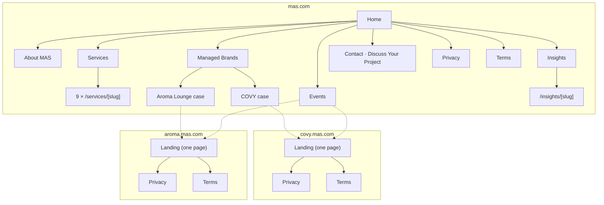

# تصميم التجربة: البراندات، وخرايط المواقع، ومشاهد الـ 3D، والفورمز

## 1. تجربة السكرول الـ 3D هتتعمل إزاي

الفيديو اللي بعته كريفرنس (لابتوب عليه آيس لاتيه كريم بروليه بيتبني مع السكرول) **مش 3D لحظي**. هو كليب واقعي متصوّر مسبقًا ومتقطع لحوالي 100–200 فريم. فيه `<canvas>` بيرسم الفريم اللي يناسب مكان السكرول، والكلام والـ labels والـ CTA عبارة عن HTML فوق الكانفاس. عشان كده شكله زي الفيلم وفي نفس الوقت ناعم.

بنستخدم تلات طبقات، وكل مشهد بياخد الطبقة المناسبة ليه:

| الطبقة | بنستخدمها في إيه | التقنية | مصدر المحتوى |
|---|---|---|---|
| **A. مشهد سينمائي** | لحظات "الواو" الواقعية: صب، أو طيران جوه المكان، أو تحوّل | `SequencePlayer` (صور على canvas، scrub بـ GSAP ScrollTrigger، ومنطقة متثبتة) | بنولده بموديلات الفيديو في MAG (Seedance 2.5 / Kling 2.5 بفريمات البداية والنهاية) ← ffmpeg ← فريمات AVIF/WebP |
| **B. 3D لحظي** | حاجات بتتفاعل مع الماوس والسكرول ومش محتاجة واقعية الصورة: أشكال هندسية، وجزيئات، وshaders | React Three Fiber + GLSL | أشكال بالكود، أو ملف GLB من `models3d_generate` في MAG، أو موديلات CC0 (Poly Haven) لو احتجنا |
| **C. موشن ديزاين** | الخطوط والظهور وانتقالات المنيو والرسومات الخطية والـ UI | GSAP (SplitText وFlip) وLenis ورسم SVG وCSS | كود + صور المصمم |

القواعد (من سكيلز `scroll-scrubbed-visual-sequence` و`build-awwwards-quality-sites` اللي ثبتناهم):
- مكان السكرول هو المرجع الوحيد للحركة، والحركة بتمشي قدام وورا.
- مفيش كلام ولا لوجوهات جوه الفريمات.
- صورة الـ poster تظهر الأول.
- كل الكلام HTML حقيقي.
- فيه بديل ثابت كامل لتقليل الحركة وللنت البطيء وللأجهزة اللي من غير WebGL.
- محرك smooth scroll واحد بس (Lenis).

كل براند ليه شخصية حركة خاصة بيه:

| البراند | شخصية الحركة | الـ Easing والإيقاع |
|---|---|---|
| MAS | دقيقة ومعمارية وواثقة، وقطعات حادة من ضوء أحمر Crimson | `power3.out`، مدد قصيرة، وتتابع سريع |
| COVY | حالمة وسريالية وطافية، الحاجات بتنجرف وبتلمع (النجمة ✦ اللي في اللوجو) | `sine.inOut`، انجراف بطيء، ومسافات سكرول طويلة |
| Aroma Lounge | دافية ومريحة وكريمة: بخار، وضوء دهبي، وخطوط مرسومة باليد | `power2.inOut`، إيقاع متوسط، وخطوط بتترسم |

## 2. أنظمة البراندات (Design Tokens)

### MAS (Proposal A)

| العنصر | القيمة |
|---|---|
| `--bg` أسود Obsidian | `#0B0B0C` |
| `--accent` أحمر Deep Crimson | `#C21F30` |
| `--fg` أوف وايت Warm Ivory | `#F3EFE7` |
| `--surface` رمادي Graphite | `#28282A` |
| خط العناوين | **Bebas Neue** (حروف كابيتال ضيقة، شبه لوجو MAS) |
| خط النصوص (لاتيني) | **Inter** (نفس خط ديك الاستراتيجية) |
| العربي | **IBM Plex Sans Arabic** (نصوص) · **Cairo** Bold (عناوين) |
| الموتيفات | مضلعات obsidian بأوجه، وخطوط حمرا رفيعة تحت عناوين السكاشن، وخدمات مترقمة |

### COVY

الألوان دي متاخدة من بكسلات دليل البراند (الدليل ما فيهوش أكواد)، ولازم مصمم البراند يأكدها.

| العنصر | القيمة |
|---|---|
| `--navy` | `#262D3F` |
| `--slate-blue` | `#7E98AE` |
| `--cocoa` | `#765F4D` |
| `--sand` | `#DCD4CF` |
| `--bronze` (من الديكور) | `#B08D57` (تقريبي، من الشبابيك البرونز المقطوعة بالليزر) |
| العناوين (بديل PassionSans) | **Tenor Sans** للعناوين الكابيتال، و**Marcellus** للعناوين الكبيرة |
| النصوص | **Outfit** (light/regular) |
| العربي | **El Messiri** (عناوين) · **Readex Pro** (نصوص) |
| الموتيفات | عروق ورق الـ caladium (لونين أزرق وكاكاو)، والنجمة الرباعية ✦، والأقواس، والشجرة الزرقا، ونقط الـ terrazzo، والشبك البرونز على شكل ورق |

### Aroma Lounge

| العنصر | القيمة (من الدليل) |
|---|---|
| `--charcoal` | `#202722` |
| `--green` | `#8EB57A` |
| `--beige` | `#E6E3D8` |
| `--grey` | `#ABA6A6` |
| ألوان مساعدة | نحاسي `#A5673F`، صدئي `#5C2E1F`، أخضر غامق `#355E3B`، زبدي `#F5E6B8` |
| العناوين والنصوص (بديل Telegraf) | **Hanken Grotesk** (أقرب grotesk مجاني، أوزان 300–800) |
| العربي | **Alexandria** (هندسي عريض، ماشي مع نسب Telegraf) |
| اللوجو | الوردمارك السكريبت وأيقونة البتلات بتوع العميل كـ SVG (عمرنا ما نعيد كتابتهم بخط) |
| الموتيفات | رسومات نباتات خطية أبيض وأسود، وأيقونة البتلات، وخطوط مزدوجة مع عناوين السكاشن (من الدليل)، وخشب غامق ولمسات دهبي |

## 3. خرايط المواقع



كل الصفحات موجودة على `/` (إنجليزي) و`/ar`.

## 4. الستوري بورد

الـ IDs بتاعة المشاهد هي نفسها اللي في الـ asset manifest. "Seq" يعني الطبقة A، و"RT3D" الطبقة B، و"Motion" الطبقة C. طول السكرول بالـ vh (ارتفاع الشاشة).

### 4.1 MAS: الهوم "From idea to operations"

| # | المشهد | الطبقة | بيحصل إيه مع السكرول | السكرول |
|---|---|---|---|---|
| M1 | **حقل الـ Obsidian** (الهيرو) | RT3D | سطح غامق بأوجه (زي خلفية المضلعات في الديك) بيلقط ضوء أحمر بيعدي عليه. لوجو MAS وجملة "Supporting business owners to achieve their goals." بيظهروا كلمة كلمة. الماوس بيميّل الأوجه سنة. ومع السكرول الكاميرا بتدخل *جوه* الأوجه | 150vh |
| M2 | الرؤية | Motion | جملة كبيرة، و"Supporting" بالأحمر، والفقرة اللي تحتها بتظهر سطر سطر | 100vh |
| M3 | **التسع أوجه** (الخدمات) | RT3D + Motion | مجسم obsidian متثبت بيلف وش لكل خدمة. الوش النشط بينور أحمر، وجنبه بيتغير اسم الخدمة ورقمها (01–09) وملخصها في سطرين. والبديل للكيبورد إن التسع خدمات يظهروا كقائمة | 400vh |
| M4 | نطاق الدعم | Motion | خط أحمر بيترسم ويعدي على Strategy ثم Marketing ثم Recruitment ثم Training ثم Guest Experience، وكل نقطة بتكشف جملة قصيرة | 120vh |
| M5 | **البابين** (البراندات) | Seq `mas.portal` | الكاميرا ماشية في ممر حجر غامق بيتقسم لقوسين: نور غابة زرقا (COVY) على الشمال، ونور لاونج دهبي دافي (Aroma Lounge) على اليمين. كروت البراندات باللوجوهات HTML فوق المشهد، ولينكاتها بتروح للـ subdomains | 250vh |
| M6 | لمحة الإيفنتس | Motion | أقرب 3 إيفنتس من البراندين، كروت بتتحرك بالعرض مع السكرول | 100vh |
| M7 | الـ CTA | Motion | "Discuss your project" بالزرار الأحمر، والفوتر | — |

### 4.2 COVY: اللاندنج "The Blue Jungle"

| # | المشهد | الطبقة | بيحصل إيه مع السكرول | السكرول |
|---|---|---|---|---|
| C1 | **من خلال الأقواس** (الهيرو) | Seq `covy.hero` | بنبدأ من الواجهة الخرسانية بالأقواس والورد الأزرق تحت سما هادية. الكاميرا بتدخل من الأبواب الإزاز، وتعدي على الـ terrazzo والشبابيك البرونز اللي على شكل ورق، وتقف قدام الشجرة الزرقا والنجمة ✦ بتلمع. لوجو COVY (SVG) بيستقر. فريمات البداية والنهاية من رندرات الديكور بتاعة العميل | 300vh |
| C2 | **لحد البار** (قصتنا) | Seq `covy.connector` | بيكمّل من آخر صورة في الـ hero. على المسقط الحقيقي، الكاميرا بتلف شمال بمحاذاة الجدارية، وتعدي على التيرازو لحد بار الباريستا، وتقرّب على كوباية تلج فوق فاترينة المخبوزات، وتخلص على أول صورة في C3 (D38). جملة البراند ("الأكل هو ألذ طريقة تقرّب بين الثقافات") بتظهر فوق اللفة على خلفية كحلي خفيفة | 545vh |
| C3 | **الكوباية المميزة** | Seq `covy.signature` | الآيس لاتيه المميز بيتبني في الكوباية فوق فاترينة المخبوزات، والبار الحقيقي وراها مش واضح (D38): لبن، ودبل إسبريسو، وكولد فوم، وكاكاو. labels بـ HTML بتظهر في نقطها، ولوجو COVY مطبوع على الكوباية (HTML، D35/D38) | 280vh |
| C6 | **الأماكن ورا الأقواس** (أماكننا) | Motion | الصالة الداخلية · التراس · البار · ركن التصوير، 3 صور لكل مكان (D39). فهرس ثابت على الجنب بيرقّم الأماكن وبينوّر اللي قدامك (صف تابات على الموبايل)؛ كل مكان صورة كبيرة على شكل قوس الواجهة بتتفتح من شق مع الـ scroll، وجنبها صورتين أصغر بيتحركوا على عمق تاني. أي صورة بتفتح عارض بملء الشاشة للـ 12 صورة (الأسهم، والسحب، وEsc) | flow |
| C5 | **المنيو** | Motion (+ أوراق RT3D على أجهزة HIGH) | التفاصيل في §5 | حسب المحتوى |
| C7 | إيفنتس COVY | Motion | من داتا الإيفنتس المشتركة | — |
| C8 | آراء العملاء | Motion | آراء placeholder مكتوب عليها "Sample" لحد ما نجيب Google Reviews | — |
| C9 | احجز / رأيك | UI | تابين: "Book a table or event" و"Share your feedback" | — |
| C10 | مكاننا | UI | العنوان والمواعيد والتليفون والواتساب ولينك الخريطة (placeholders)، وفوتر فيه السوشيال. صورة القوس هي صورتنا للأبواب الزجاج من التراس (D42) | — |

ترتيب الصفحة: C1، C2، C3، C6، C5، C7–C10. **C4 The Taste of Everywhere** (حلقة الورق الـ 3D بين المطابخ الخمسة) اتشال من صفحة COVY من D42؛ والكود بتاعه فاضل في الريبو (`taste.tsx` و`cuisines.tsx` وحلقة الورق في `@mas/three`) عشان يتعمل تاني لـ Aroma Lounge بهوية Aroma.

### 4.3 Aroma Lounge: اللاندنج "Good food, good hearts"

| # | المشهد | الطبقة | بيحصل إيه مع السكرول | السكرول |
|---|---|---|---|---|
| A1 | **الريحة طالعة** (الهيرو) | Seq `aroma.hero` + Motion | ترابيزة خشب غامق وقت الغروب، والبخار طالع من طاسة باييا لسه نازلة ومتلفّف لفوق. ومع طلوعه الوردمارك السكريبت "Aroma Lounge" بيترسم حرف حرف (SVG فوق المشهد، مش جوه الفريمات) | 250vh |
| A2 | الشعار | Motion | "Good food comes from good hearts, we aspire for both." — محمود يونس، المؤسس | 100vh |
| A3 | من 2006 | Motion | تايملاين: الافتتاح في سيتي ستارز (1,200 متر، منهم تراس 900 متر)، ثم تطويرين كبار، ثم النهارده. والأرقام بتعد لفوق | 150vh |
| A4 | الشغف · التنوع · الإبداع | Motion | تلات بانلز متثبتة، ومع كل قيمة بتترسم رسمة نباتات خطية (من باترن الدليل) | 200vh |
| A5 | **التراس من المغرب لليل** | Seq `aroma.terrace` | لقطة واسعة للتراس: نهار ثم غروب ثم ليل، والإضاءة الدافية بتنور، والزرع بيتهز. والكلام عن تجربة الاسترخاء | 250vh |
| A6 | **المنيو** | Motion | التفاصيل في §5 (رسومات خطية لكل قسم) | حسب المحتوى |
| A7 | الإيفنتس، وآراء العملاء، والحجز والفيدباك، ومكاننا | UI | نفس هيكل COVY بستايل Aroma | — |

## 5. تجربة المنيو (COVY وAroma)

المنيو محتوى طويل، فلازم يفضل سريع وسهل التصفح. الـ "واو" في الانتقالات، ومش على حساب المستخدم.

- **افتتاحية لكل قسم:** كل قسم بيبدأ بلحظة متثبتة قصيرة (≤ 80vh). اسم القسم بيظهر كبير مقسّم حروف، وصورة طبق رئيسي (ImageSlot) بتكبر من كارت لعرض الشاشة كله. في COVY ورقة caladium بتلف وتستقر (RT3D على أجهزة HIGH، وCSS على الباقي)، وفي Aroma رسمة نباتات خطية بتترسم.
- **قائمة الأصناف:** عمودين على الديسكتوب وعمود على الموبايل. الاسم، ووصف قصير، والسعر، وعلامات النوع، وصورة صغيرة (ImageSlot). الأصناف بتظهر بتتابع هادي، وعمرها ما تستخبى ورا حركة.
- **شريط أقسام ثابت** بيعرف القسم الحالي (المؤشر بيتحرك بـ Flip)، ومعكوس في العربي. وعلى الموبايل bottom sheet "Jump to category".
- **بحث وفلترة** (في المتصفح، وفوري): بحث بالكلام، وعلامات (نباتي، حار، مميز، جديد).
- **احجز من المنيو:** زرار عايم "Book a table" بيفتح شيت الحجز.
- المحتوى HTML حقيقي عشان الـ SEO، ومعاه JSON-LD لـ `Menu` و`MenuSection` و`MenuItem`.

## 6. تجربة الفورمز

لغة تصميم مشتركة:
- حقول كبيرة سهل الضغط عليها، والـ labels ظاهرة دايمًا.
- التحقق بيحصل لما تسيب الحقل، والأخطاء بلغة بسيطة باللغتين.
- كل حاجة توصلها بالكيبورد.
- `autocomplete`، و`inputmode` للموبايل والأرقام.
- مفيش ألغاز CAPTCHA (Turnstile شغال في الخلفية).

### 6.1 الحجز (COVY وAroma): 3 خطوات في شيت أو سكشن

| الخطوة | الحقول | ملاحظات |
|---|---|---|
| 1 · إيه وإمتى | **النوع** (كروت بأيقونات: ترابيزة · عيد ميلاد · مناسبة خاصة · شركات · المكان بالكامل · منطقة الشيشة) · **التاريخ** (كالندر، الأيام اللي فاتت مقفولة، لحد 60 يوم) · **الساعة** (اختيارات من ساعات العمل، كل 30 دقيقة) · **عدد الأفراد** (ترابيزة 1–20، والمناسبات من 10 لـ 300) · **مكان القعدة** (جوه / بره / مش فارقة) | لو اخترت نوع مناسبة بيظهر "احكيلنا عن المناسبة" في الخطوة 2. ولو العدد أكبر من حد الترابيزة بنقترح تحويله لنوع مناسبة |
| 2 · بياناتك | **الاسم بالكامل** · **الموبايل** (افتراضي +20، بيتحقق منه وبيتحول لصيغة E.164) · **الإيميل** (للتأكيد) · **تفاصيل المناسبة** (لأنواع المناسبات) · **طلبات خاصة** (حساسية، كرسي أطفال، احتياجات حركة، ديكور) | علامة موافقة على الخصوصية بلينك للسياسة |
| 3 · راجع وابعت | كارت ملخص، ولينك تعديل لكل خطوة | بعد النجاح: رقم مرجعي، وجملة "طلبك لسه ما اتأكدش، الفريق هيكلمك قريب يأكده"، وزراير اتصال وواتساب |

**إيميل المطعم** عنوانه بالشكل ده: `[COVY] Birthday · Sat 14 Nov 2026 · 19:30 · 8 guests · CV-7K3P`. جواه جدول بكل الحقول ولينكات بضغطة واحدة: `tel:` و`wa.me` و`mailto:`. والـ Reply-To هو إيميل الضيف.

**الرد التلقائي للضيف** بلغته وبستايل البراند، وفيه ملخص الطلب ولينكات التواصل.

### 6.2 الفيدباك (COVY وAroma)

- تقييم بالنجوم: العام إجباري، والأكل والخدمة والجو اختياري.
- تاريخ الزيارة.
- تعليق إجباري (10–2,000 حرف).
- اختيار "كلموني بخصوص رأيي"، ولو اتفعّل يظهر الاسم والإيميل أو الموبايل.

لو التقييم العام ≤ 2 بيتكتب `[Needs follow-up]` في عنوان الإيميل.

### 6.3 "Discuss Your Project" (MAS)

| الحقل | النوع | إجباري |
|---|---|---|
| الاسم بالكامل | نص | ✓ |
| اسم الشركة أو البراند | نص | — |
| دورك | اختيار: Owner · Investor · Manager · Other | ✓ |
| الإيميل | إيميل | ✓ |
| الموبايل | تليفون (افتراضي +20) | ✓ |
| مرحلة البيزنس | كروت: Idea · Opening soon · Operating (1 branch) · Multi-branch / franchise | ✓ |
| الخدمات المطلوبة | اختيار متعدد (التسع خدمات) | ✓ (واحدة على الأقل) |
| المدينة | نص باقتراحات (القاهرة، الجيزة، إسكندرية، الساحل الشمالي، أخرى) | — |
| التوقيت | اختيار: ASAP · 1–3 months · 3–6 months · 6+ months | — |
| الميزانية | اختيار، ومعاه "Prefer not to say" | — |
| تفاصيل المشروع | نص طويل 20–3,000 حرف | ✓ |
| الموافقة | علامة صح | ✓ |

الإيميل بيروح لـ `mas@mas.com`، والرد التلقائي بيقول إن الفريق هيرد خلال يوم عمل.

## 7. نظام الـ Placeholders (قاعدتك)

```tsx
<ImageSlot id="covy.menu.mezze.hero" width={1600} height={1000} alt="Mezze platter" />
```

لحد ما ييجي `src` بيعرض البوكس ده:

```
┌──────────────────────────────────────────┐
│                                          │
│        1600 × 1000 px · 16:10            │
│        covy.menu.mezze.hero              │
│        Mezze platter                     │
│                                          │
└──────────────────────────────────────────┘
```

- البوكس بلون سطح البراند، وبإطار متقطع 1 بكسل، وخطوط مايلة خفيفة، فمستحيل يتلخبط مع صورة نهائية.
- بيحجز نفس نسبة الصورة بالظبط على كل المقاسات (CLS = 0). وبيعرض مقاس *التسليم* (ضعف أكبر مقاس معروض)، مش مقاس الـ CSS.
- `SequenceSlot` بيعرض `Sequence · 150 frames · 1920×1080 (desktop) / 1080×1350 (mobile) · covy.hero`.
- `pnpm assets:manifest` بيطلّع `docs/assets/asset-manifest.md` من الكود. الملف فيه لكل مكان: الـ ID، والصفحة والسكشن، ومقاس التسليم، والنسبة، والفورمات (الماستر PNG/TIFF)، والـ alt بالإنجليزي والعربي، والحالة. ده الـ checklist بتاع المصمم.

## 8. الكتابة والمحتوى

- إحنا اللي بنكتب الكلام بسكيل `copywriting`، وبعدين بنراجعه بـ `humanizer` و`no-ai-slop`. العربي بيتكتب عربي من الأول (مش ترجمة آلية)، والعميل بيراجعه.
- النبرة: **MAS** واثقة وعملية، و**COVY** شاعرية ولفّت العالم، و**Aroma Lounge** دافية وكريمة ومرحّبة.
- مفيش مبالغات ما نقدرش نثبتها، ولا أرقام مخترعة، ولا آراء مزيفة (من قواعد سكيل الكتابة والقرار D7).
