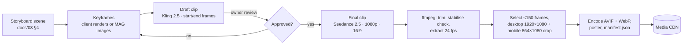

# خط إنتاج الأصول: مشاهد MAG، وموديلات الـ 3D، وصور المصمم

## 1. مين بيعمل إيه

| الأصل | مين بيعمله | بيتسلم إزاي |
|---|---|---|
| الصور الثابتة (الهيروز، والأطباق، والأماكن، والإيفنتس، وصور OG) | **المصمم الجرافيك** | ماستر PNG/TIFF بمقاس التسليم بتاع المكان، وإحنا بنحوله لـ AVIF/WebP |
| مشاهد السكرول (الطبقة A) | **إحنا بـ MAG** | فيديو يتحول لفريمات عن طريق `tools/sequences` |
| الـ 3D اللحظي (الطبقة B) | **إحنا** | أشكال وshaders بالكود، وملف GLB من `models3d_generate` في MAG أو مصادر CC0 بس لو احتجنا |
| اللوجوهات | **العميل أو مصممين البراند** | SVG (كل النسخ: الكامل، والأيقونة، وفاتح وغامق) |

لحد ما صورة المصمم توصل، بيظهر بوكس الـ `ImageSlot` مكانها (قاعدتك، `CLAUDE.md` §3).

## 2. خطوات إنتاج المشهد

1. **فريمات المفتاح (Keyframes):** فريم البداية وفريم النهاية بيحددوا كل لقطة. في COVY بنستخدم رندرات الديكور بتاعة العميل (الواجهة، والشجرة الزرقا، والبار، والـ terrazzo) كمرجع أو كفريم بداية، عشان المكان المتولد يطابق المطعم الحقيقي. وفي MAS وAroma بنولّد الـ keyframes بألوان البراند بموديلات الصور في MAG.
2. **المسودات:** Kling 2.5 بجودة 1080p لمدة 10 ثواني، بفريم بداية + نهاية (650 كريديت للواحدة). هنا بنجرب الحركة ومسار الكاميرا بتكلفة قليلة.
3. **النسخة النهائية:** Seedance 2.5 بجودة 1080p ونسبة 16:9 لمدة 10 ثواني، والـ keyframes المتوافق عليها كمرجع (7,900 كريديت للواحدة).
4. **الموبايل:** بنقص من ماستر الـ 16:9 لنسبة 4:5 (864×1080) حوالين نقطة تركيز محددة لكل مشهد، فمش محتاجين نولّد تاني.
5. **قواعد كتابة الـ prompts:**
   - مفيش كلام ولا لوجوهات ولا علامات براند ولا وشوش ناس قريبة جوه الفريمات.
   - حركة كاميرا بطيئة وثابتة، لأنها بتتسكرل أنعم.
   - اتجاه الإضاءة ثابت.
   - مساحات هادية متسابة للكلام اللي هيتحط فوقها بـ HTML.
6. **المعالجة (`tools/sequences`):**
   - `ffmpeg` بيطلّع الفريمات على 24 فريم في الثانية.
   - بنختار لحد 150 فريم بالتساوي على الوقت (توازن بين نعومة الحركة والحجم)، أو بـ `--motion-step` على حسب قد إيه الصورة بتتغير: الحركة السريعة بتاخد كل فريماتها، والـ manifest بيشيل منحنى `timing` الـ player بيمشي عليه عشان الكاميرا تتحرك بسرعة ثابتة مع السكرول (D41).
   - بنعمل encode بـ `avifenc` أو ffmpeg AV1 بجودة متظبطة لكل مشهد، ومعاه WebP كبديل.
   - بنطلّع فريم الـ poster.
   - بنكتب `manifest.json` (`id`، و`frameCount`، والنسخ، والمقاسات، والـ poster، ونقطة التركيز، و`copyStops`).

## 3. ميزانية الكريديت (MAG، خطة مدفوعة أصلًا)

الرصيد يوم 2026-10-29: **365,361 كريديت** (Premium+). وضع الـ unlimited مش شغال هنا، فالتوليد بيخصم من الكريديت. الأسعار اللي تحت أسعار مظبوطة من الـ cost simulator بتاع MAG.

| البند | سعر الوحدة | للمشهد الواحد | × 5 مشاهد |
|---|---|---|---|
| صور keyframes (~4) | ~100 | 400 | 2,000 |
| مسودات Kling 2.5 بجودة 1080p لمدة 10 ث (~4) | 650 | 2,600 | 13,000 |
| نسخ نهائية Seedance 2.5 بجودة 1080p لمدة 10 ث (لحد 2) | 7,900 | 15,800 | 79,000 |
| **المجموع** | | **18,800** | **94,000** |
| موديلات 3D (Tripo 3.1 لو احتجنا، ~2) | 580 | — | 1,160 |
| احتياطي (إعادة تصوير، upscale) | | | 15,000 |
| **سقف المشروع** | | | **≈ 110,000 كريديت (~30% من الرصيد)** |

المشاهد هي: `mas.portal` و`covy.hero` و`covy.signature` و`aroma.hero` و`aroma.terrace`. قبل أي دفعة توليد بنعرض التكلفة بالظبط ونستنى موافقتك.

## 4. موديلات الـ 3D (لو مشهد محتاج مجسم بس)

المرشحين: الشجرة الزرقا بتاعة COVY (لو نقلناها للـ 3D اللحظي في افتتاحيات المنيو)، وكوباية COVY.

الخطوات:
1. `models3d_generate` في MAG (Tripo 3.1 من رندرات العميل).
2. `models3d_remesh` لو احتجنا.
3. glTF-Transform (Meshopt + تكسترز KTX2).
4. ملف GLB ≤ 1.5 ميجا بيتحمل لما نحتاجه.

قبل كده بنشوف بدائل CC0 من Poly Haven للحاجات العامة.

## 5. التسليم للمصمم

- `docs/assets/asset-manifest.md` بيتولد من الكود، وفيه كل الأماكن: الـ ID، والصفحة والسكشن، ومقاس التسليم، والنسبة، والـ alt بالإنجليزي والعربي، والحالة.
- الماستر بيتسلم بضعف أكبر مقاس معروض، وإحنا بنتولى الضغط والمقاسات المختلفة.
- اتجاه تصوير الأكل لكل براند:
  - **COVY:** إضاءة زرقا وكاكاو باردة، مع terrazzo وبرونز.
  - **Aroma Lounge:** خشب دافي، وضوء دهبي، ولمسات خضرا.
  - **MAS:** غامق وعالي التباين، مع لمسات أحمر.
