# الخطة الرئيسية

الشغل ماشي على فيزات بموافقات: أي فيز ما تبدأش غير لما صاحب المشروع يوافق على اللي قبلها. أول بوابة خارجية هي Milestone A، يعني ديمو التلات صفحات (الهوم واللاندنجز) للعميل.

```mermaid
flowchart LR
  P0[P0 · Planning] --> P1[P1 · Foundations]
  P1 --> P2[P2 · Art direction &<br/>motion prototypes]
  P2 --> P3[P3 · COVY landing]
  P3 --> P4[P4 · Aroma landing]
  P4 --> P5[P5 · MAS home]
  P5 --> MA{{Milestone A<br/>client demo}}
  MA --> P6[P6 · MAS full site]
  P6 --> P7[P7 · Real content swap]
  P7 --> P8[P8 · Pre-launch hardening]
  P8 --> MB{{Milestone B<br/>client sign-off}}
  MB --> P9[P9 · Launch & handover]
```

## P0: الاكتشاف والتخطيط ✅ (مستني الموافقة)

**التسليمات:** سجل القرارات، والـ PRD، والمعمارية وتصميم النظام (بالرسومات)، وتصميم التجربة والستوري بورد، وخط إنتاج الأصول وميزانية الكريديت، والخطة دي، و`CLAUDE.md`، و28 سكيل متفحصين.

**البوابة:** صاحب المشروع يوافق على الوثائق. النقاط المفتوحة O1–O3 اتجاوبت في D25–D27.

## P1: الأساسات

- Turborepo + pnpm، وتلات تطبيقات Next.js، وهياكل الـ packages المشتركة، وTS strict، وlint وformat، وخط الـ CI.
- Design tokens وTailwind presets لـ MAS وCOVY وAroma، والخطوط المجانية مع العربي بتاعها، وأدوات الـ RTL.
- next-intl للـ routes (`/` و`/ar`)، وزرار اللغة، والرسايل المشتركة.
- `ImageSlot` و`SequenceSlot`، ومولد الـ asset manifest.
- `MotionProvider` (Lenis + ScrollTrigger + مستويات الأجهزة + تقليل الحركة)، و`SequencePlayer` شغال على مشهد تجريبي.
- بانر الموافقة، وتحميل GA4 وClarity (بـ IDs تجريبية)، وقوالب الصفحات القانونية.
- package الفورمز: الـ schemas، وكومبوننتس الحجز والفيدباك والاستفسار، والـ route handler، وقوالب React Email، وTurnstile. وResend على test mode.
- تلات مشاريع على Vercel Hobby بـ preview deployments.

**البوابة:** صاحب المشروع يراجع صفحة "kitchen sink" لكل براند فيها: الـ tokens، والخطوط، والبوكسات، والفورمز، ومشهد تجريبي بيتسكرل، والموافقة.

## P2: الاتجاه الفني ونماذج الحركة

- لوحة اتجاه فني لكل براند متعمولة في المتصفح (خطوط، وألوان، وملمس، وعينات حركة).
- keyframes من MAG + مسودات Kling للخمس مشاهد (حوالي 15 ألف كريديت، والتكلفة بتتعرض الأول).
- نماذج 3D لحظية: حقل الـ obsidian في MAS والمجسم أبو تسع أوجه، وحلقة الأوراق في COVY.
- فحص أداء النماذج على موبايل أندرويد متوسط.

**البوابة:** صاحب المشروع يوافق على شكل وحركة كل مشهد قبل ما نولّد النسخ النهائية.

## P3: لاندنج COVY (إنجليزي + عربي)

- المشاهد النهائية `covy.hero` و`covy.signature`.
- كل السكاشن من C1 لـ C10.
- المنيو المبدئي (كل الأقسام).
- الحجز والفيدباك شغالين على إيميل التجربة.
- JSON-LD (Restaurant وMenu)، وصفحات الخصوصية والشروط.
- المراجعات: `audit-ai-design-slop` و`review-animations` و`accessibility` و`core-web-vitals`.

## P4: لاندنج Aroma Lounge (إنجليزي + عربي)

زي P3 بالظبط، بالسكاشن من A1 لـ A7 والمشاهد `aroma.hero` و`aroma.terrace`.

## P5: هوم MAS (إنجليزي + عربي)

السكاشن من M1 لـ M7، ومشهد `mas.portal`، والمشاهد اللحظية، ولينكات لـ subdomains البراندات (لينكات الـ preview).

## Milestone A: ديمو العميل

- نشغّل شروط القبول اللي في `01-prd.md` §8.
- نسلّم صاحب المشروع سكريبت ديمو بلينكات الـ preview.
- نجمع الملاحظات.

**البوابة:** موافقة العميل، وبعدها P6.

## P6: موقع MAS كامل

- About.
- فهرس Services + 9 صفحات للخدمات.
- Managed Brands (صفحتين للبراندين).
- Events (فلاتر، والجاي والفات).
- Insights (قائمة MDX + قالب مقال + مقالين للبداية).
- Contact بفورم الاستفسار.
- الخصوصية والشروط.

ونفس سكيلز المراجعة اللي فوق.

## P7: استبدال المحتوى بالحقيقي

- العميل يسلّم: المنيو والأسعار الحقيقية، والفروع، والمواعيد، والتليفونات والواتساب، ولينكات السوشيال، وملفات اللوجو SVG، والإيفنتس، وآراء Google Reviews.
- المصمم يسلّم صور كل الأماكن.
- تقرير الـ placeholders يوصل لصفر.
- العميل يراجع الكلام العربي.

## P8: التجهيز قبل الإطلاق

- **SEO** (`seo-audit` و`ai-seo` و`schema`): metadata، وصور OG، وsitemaps، وrobots، وhreflang، و`llms.txt`.
- **مراجعة أمان** (`security-and-hardening`)، وتثبيت الـ CSP، والتأكد من الـ headers.
- مراجعة كاملة للـ accessibility والأداء.
- اختبار على متصفحات وأجهزة مختلفة.
- اختبار وصول الإيميلات (SPF وDKIM وDMARC).
- التأكد من الموافقة والأناليتكس على GA4 وClarity بتوع العميل.

**البوابة:** Milestone B، يعني توقيع العميل بالموافقة.

## P9: الإطلاق والتسليم

1. العميل يعمل حساب Vercel Pro أو يرقّي حسابه، وإحنا ننقل المشاريع.
2. نقل الـ DNS: الدومين الأساسي، و`www`، و`covy`، و`aroma`، وrecords بتاعة Resend، و`media` لـ R2.
3. متغيرات بيئة الإنتاج، والتحقق في Search Console، واختبارات سريعة، ومتابعة 48 ساعة.
4. ملف التسليم: دليل التشغيل (إزاي تعدل داتا المنيو والإيفنتس، وتضيف مقال، وتغيّر المفاتيح)، وchecklist بالحسابات، ومصادر الأصول.

## المطلوب من العميل (بيتجمع في P7، ومش موقّف الفيزات اللي قبلها)

- المنيو والأسعار الحقيقية.
- مواعيد العمل لكل فرع.
- العناوين ومكانها على الخريطة.
- التليفون والواتساب.
- لينكات السوشيال.
- ملفات اللوجو SVG (MAS وCOVY وAroma Lounge).
- قائمة الإيفنتس.
- إذن باستخدام Google Reviews.
- الاسم القانوني للكيان وعنوانه لسياسة الخصوصية.
- سياسات الحجز (أقصى عدد، والمدة قبل الحجز، والحد الأدنى للشيشة، والإلغاء).
- حسابات Google وMicrosoft لـ GA4 وClarity.
- حساب Vercel Pro وقت التسليم.

## المخاطر

| الخطر | الأثر | الحل |
|---|---|---|
| حد Resend المجاني: 100 إيميل في اليوم (يعني حوالي 50 حجز في اليوم مع الردود التلقائية) | إيميلات بتضيع في الأيام الزحمة | Turnstile + honeypot، ومتابعة الاستهلاك، والعميل يقدر يرقّي Resend وقت التسليم لو الحجم محتاج |
| Vercel Hobby غير تجاري وليه حدود في الـ bandwidth | مينفعش نطلق للجمهور عليه | الـ previews بس على Hobby، والإنتاج على Pro بتاع العميل، وفريمات المشاهد على R2 (D25) |
| أخطاء في فيديوهات الـ AI أو تفاصيل بعيدة عن البراند | الـ "واو" يضعف، أو يبان إنه AI | رندرات العميل كفريمات بداية، ولقطات قصيرة متحكم فيها، ومفيش كلام جوه الفريمات، ومراجعتك على المسودات، و`audit-ai-design-slop` |
| أداء الموبايل مع المشاهد والـ WebGL | Core Web Vitals ضعيفة واستهلاك بطارية | مستويات الأجهزة، وقص للموبايل بنص عدد الفريمات، وتحميل الـ 3D بعدين، وصور poster للـ LCP |
| الخطوط البديلة بعيدة عن البراند | عدم تطابق مع البراند | مقارنة بصرية في P2 وموافقتك |
| جودة الكلام العربي | المصداقية | كتابة عربي من الأول + مراجعة العميل في P7 |
| placeholders متنسية وقت الإطلاق | معلومات مضللة | علامات `placeholder: true` + تقرير في الـ CI لازم يبقى صفر قبل Milestone B |
